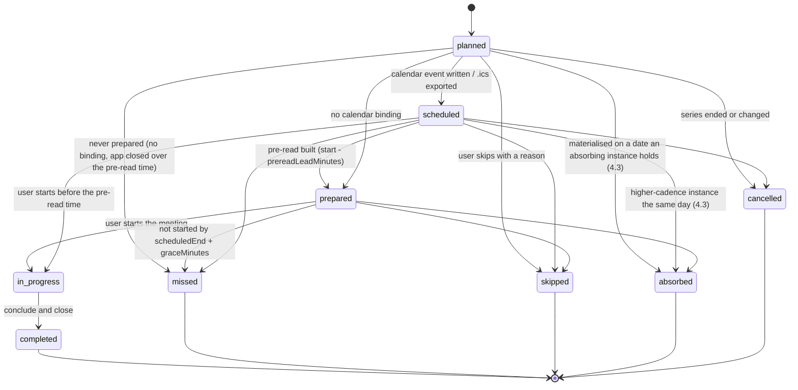

# 02 · Rhythm and calendar

- **Purpose:** Defines how a chosen rhythm (daily, weekly, monthly, quarterly, yearly) becomes meeting series and instances on the user's calendar. Covers each meeting's agenda, its inputs and outputs, how the app keeps to the rhythm, and how unfinished items carry forward and escalate. Calendar sync is modular: the rhythm engine talks to any external calendar through one `CalendarProvider` contract (§9.1), which calendar connectors implement.
- **Depends on:** [01](01-onboarding-and-frameworks.md) (`FrameworkInstance`, `BackboneMeeting`, `ProtectedBlock`, invariants E-1, X-3, PO-4). [03](03-decisions-and-action-items.md) (`ActionItem`, `Decision`, `Issue`, `Measure`, lifecycle and escalation fields).
- **Related files:** [05](05-connectors.md) (calendar connectors such as `google-calendar` implement the `calendar@1` contract, [05 §5](05-connectors.md#5-manifest) `implements`). [06](06-connector-discovery.md) (a missing calendar provider goes through discovery). [08](08-repository-and-automation.md) (the engine lives in `cc-foundation`, calendar connectors in `cc-connectors`, the calendar mapping in the user's engine `cc.config`). [04 §7](04-platform.md#7-policy-engine-and-confirmations) (confirmation of calendar writes). [07](07-agent-friendly-design.md) (`cc-axi meetings ...`, MCP `cc_meeting_*`). [09](09-build-plan.md) (`.ics` in P1, live calendar sync in P2).

## 1. Summary

1. A framework instance's backbone meetings become **meeting series**: an RFC 5545 RRULE in a time zone, a duration and an agenda template. Same-cadence meetings of workstreams run by one person may be **merged** into one series (§4.4).
2. The **rhythm engine** materialises **meeting instances** over a rolling horizon. It writes them to the calendar, builds a **pre-read** before each one, opens it at start time, captures outputs during it, closes it, and seeds the next one.
3. Every agenda section declares typed **inputs** (queries over the data model) and the **outputs** it may create. Each output must carry an owner and a due date, or a decider.
4. The calendar is a projection. CC owns the events it creates and reconciles them every 15 minutes. A user's move in the calendar is accepted as a one-off reschedule inside the same period. Anything else becomes a decision for the user (§9.4).
5. Unfinished items carry forward automatically, because the next instance's inputs are queries. Every review that sees an overdue item increments its `carryCount`. Thresholds escalate it: reminder, flag, issue in the weekly meeting, monthly review, quarterly close-out (§7). Items leave only as `verified_done` or `dropped` with a reason.
6. **Calendar sync is modular.** The rhythm engine (series, instances, carry-forward, escalation, reconciliation) is foundation code and contains no provider code. Each external calendar (Google, Microsoft 365 or Outlook, CalDAV services such as iCloud or Fastmail) is a connector that implements the `CalendarProvider` contract (§9.1). The user's engine holds only the choice and the mapping: which calendars, which workstreams sync where, titles and colours, and several calendars at once (§9.6). Without any calendar binding, the foundation's `.ics` export is the fallback.

## 2. Scope and non-goals

- In scope: series and instance types, placement, the instance lifecycle, agenda templates, pre-reads, output capture, carry-forward, escalation, calendar reconciliation, notifications.
- Non-goals: video calls, transcription and note-taking (CC captures structured outputs; an AI note-taker's output may be pasted into a meeting's notes, see OQ-02-03); inviting other people in solo mode.

## 3. Types

```ts
interface MeetingSeries {
  id: MeetingSeriesId;
  name: string;                           // "Weekly CEO review"
  cadence: Cadence;                       // 01 §4
  rrule: string;                          // RFC 5545, local to timeZone; RDATE/EXDATE allowed; the ADR 0001 subset (decision 4)
  dtstart: string;                        // local "YYYY-MM-DDTHH:MM" of the first occurrence; synced on every create or change (ADR 0001 decision 5)
  timeZone: IanaTimeZone;
  durationMinutes: number;                // within BackboneMeeting bounds
  workstreamIds: WorkstreamId[];          // length > 1 = merged series (§4.4)
  frameworkInstanceIds: FrameworkInstanceId[];
  backboneMeetingKey: string;             // e.g. "weekly"; "portfolio.daily-start" for §4.5
  agendaTemplateId: string;               // §5, e.g. "agenda.eos-lite.weekly@1"
  agendaOverrides: { sectionId: string; timeboxMinutes: number }[]; // within section bounds
  attendeeIds: PersonId[];                // solo mode: [self]
  chairId: PersonId;
  mode: 'solo' | 'team';
  absorbs: { cadence: Cadence; absorbedMinutes: number }[]; // §4.3
  calendars: SeriesCalendarBinding[];    // empty = no calendar binding (.ics export only); several = the same events on each
  prereadLeadMinutes: number;             // default 1440 (24 h); daily meetings 30
  reminderMinutes: number[];              // default [15]
  graceMinutes: number;                   // default 60; see §4.2
  status: 'active' | 'paused' | 'ended';
}

interface SeriesCalendarBinding {
  bindingId: ConnectorBindingId;          // a binding of any connector that implements calendar@1 (§9.1)
  calendarId: string;                     // calendar chosen or created at onboarding; resolved from the mapping (§9.6)
  role: 'primary' | 'mirror';             // exactly one primary per series: its moves are accepted first (§9.4)
  colour?: string;                        // from the mapping, when the provider supports colours
  titleTemplate: string;                  // "[CC] {{series.name}}"; sensitive workstreams use neutral titles
  inviteAttendees: boolean;               // false in solo mode; true needs send_publish confirmation
}

type InstanceState =
  | 'planned'      // materialised, not yet on the calendar
  | 'scheduled'    // calendar event exists (or .ics exported)
  | 'prepared'     // pre-read built
  | 'in_progress'
  | 'completed'
  | 'missed'       // not started by scheduledEnd + graceMinutes
  | 'skipped'      // user skipped it in advance, with a reason
  | 'absorbed'     // folded into a higher-cadence instance the same day (§4.3)
  | 'cancelled';   // series ended or changed

interface MeetingInstance {
  id: MeetingInstanceId;
  ref: HumanRef;                          // "M-0031"
  seriesId: MeetingSeriesId;
  occurrenceStart: UtcTimestamp;          // the RRULE occurrence it materialises; a one-off reschedule keeps it (C-02-02)
  scheduledStart: UtcTimestamp;
  scheduledEnd: UtcTimestamp;
  actualStart?: UtcTimestamp;
  actualEnd?: UtcTimestamp;
  state: InstanceState;
  agenda: AgendaSectionInstance[];        // snapshot taken when the pre-read is built
  preread?: { builtAt: UtcTimestamp; snapshotSha256: string; renderedSha256: string; inputsHash: string };
  outputs: MeetingOutputs;
  calendarEvents: { bindingId: ConnectorBindingId; calendarId: string; eventId: string; etag: string; lastSyncedAt: UtcTimestamp }[];  // one per bound calendar
  carriedFrom: MeetingInstanceId[];       // missed instances whose agenda carried in
  absorbedInstanceIds: MeetingInstanceId[];
  absorbedBy?: MeetingInstanceId;
  skipReason?: string;
  rescheduledFrom?: { start: UtcTimestamp; by: Actor; at: UtcTimestamp };
  readBackConfirmedAt?: UtcTimestamp;     // conclude step (§6.4)
  rating?: number;                        // 1-10, team mode or if enabled
  notes: string;                          // free text; may be AI-summarised, labelled as such
}

type AgendaSectionType =
  | 'attention' | 'check_in' | 'scorecard' | 'goals_review' | 'action_review'
  | 'headlines' | 'issues' | 'decision_queue' | 'plan_commitments' | 'pipeline_review'
  | 'content_review' | 'money_ops' | 'register_health' | 'risk_review' | 'rhythm_health'
  | 'top_three' | 'day_close' | 'planning' | 'retrospective' | 'conclude';

type OutputKind =
  | 'decision' | 'action_item' | 'issue' | 'risk' | 'measure_value' | 'goal'
  | 'goal_grade' | 'status_update' | 'verification' | 'note';

interface AgendaSectionTemplate {
  id: string;                             // unique in the agenda template, e.g. "scorecard"
  type: AgendaSectionType;
  title: string;
  timeboxMinutes: number;                 // solo mode, one workstream (§5.1 "Solo, single workstream")
  variants?: { team?: number; soloMerged?: number };  // §5.1's other columns; soloMerged is per workstream when perWorkstream
  minMinutes: number;                     // §5 bounds rule
  maxMinutes: number;
  backbone: boolean;                      // true = required by the framework invariant
  perWorkstream: boolean;                 // repeated once per workstream in a merged meeting
  inputs: InputQuery[];
  allowedOutputs: OutputKind[];
  rules: string[];                        // human-readable; enforced by section validators
}

interface AgendaTemplate {
  id: string;                             // "agenda.eos-lite.weekly@1"
  sections: AgendaSectionTemplate[];      // ordered; order of backbone sections is an invariant
  slots: string[];                        // extension slots for packs, e.g. "after:headlines"
}

interface AgendaSectionInstance {
  sectionId: string;
  workstreamId?: WorkstreamId;            // set when perWorkstream
  absorbedFrom?: MeetingInstanceId;       // on an absorbing instance: the absorbed instance the section comes from (§4.3)
  timeboxMinutes: number;
  inputResults: { queryId: string; count: number; itemRefs: string[]; flags: string[] }[];
  status: 'pending' | 'done' | 'skipped';
}

interface MeetingOutputs {
  decisionIds: DecisionId[];
  actionItemIds: ActionItemId[];
  issueIds: IssueId[];
  riskIds: RiskId[];
  measureValueIds: string[];
  goalIds: GoalId[];
  statusUpdates: { ref: string; field: 'lifecycle' | 'health' | 'due'; from: string; to: string }[];
  verifications: { actionItemId: ActionItemId; result: 'confirmed' | 'attested' | 'rejected' }[];
}

/** Relative times are resolved against the instance being prepared. */
type RelativeTime =
  | 'instance.start' | 'instance.end' | 'previous_instance.end' | 'next_instance.start'
  | `instance.start+${number}d` | `instance.start-${number}d`;

type WorkstreamScope = 'meeting' | WorkstreamId[];   // 'meeting' = the series' workstreams

type InputQuery =
  | { id: string; source: 'action_items'; filter: { scope: WorkstreamScope; lifecycle?: Lifecycle[];
        dueBefore?: RelativeTime; claimedSince?: RelativeTime; escalationAtLeast?: 0 | 1 | 2 | 3 | 4;
        ownerIds?: PersonId[]; sourceMeetingSeries?: boolean }; limit?: number }
  | { id: string; source: 'measures'; filter: { scope: WorkstreamScope; role?: 'lead' | 'lag' }; periods: number }
  | { id: string; source: 'goals'; filter: { scope: WorkstreamScope; period: 'current' | 'previous' | 'next' } }
  | { id: string; source: 'decisions'; filter: { scope: WorkstreamScope; status: DecisionStatus[]; dueBefore?: RelativeTime } }
  | { id: string; source: 'issues'; filter: { scope: WorkstreamScope; status: ('open')[] } }
  | { id: string; source: 'risks'; filter: { scope: WorkstreamScope; status: ('watching' | 'triggered')[] } }
  | { id: string; source: 'register_health'; filter: { scope: WorkstreamScope; window: 'month' | 'quarter' } }
  | { id: string; source: 'rhythm_health'; filter: { window: 'month' | 'quarter' } }
  | { id: string; source: 'attention' }   // confirmations pending, sessions needing the user, escalations >= 2,
                                          // development requests awaiting review (06 §11.1), backup warnings (04 §9.1)
  | { id: string; source: 'connector'; bindingId?: ConnectorBindingId; action: string;
        input: Record<string, unknown> };  // only actions with risk 'read' (05); a pack's section names no binding
                                          // until one is bound, and resolves as a flagged empty input (§6.1)
```

`Cadence`, `Lifecycle`, `DecisionStatus` and the ID types are defined in [01](01-onboarding-and-frameworks.md) and [03](03-decisions-and-action-items.md). Both records also carry the audit fields of [03 §3](03-decisions-and-action-items.md#3-common-conventions). The `rrule` text is the RRULE value, optionally followed by `RDATE:` and `EXDATE:` lines of local `YYYYMMDDTHHMMSS` times, and CC stores its own canonical form of it ([ADR 0001](../adr/0001-recurrence-and-time-zone-libraries.md) decision 4).

## 4. Rhythm engine

### 4.1 Horizon and materialisation

1. Instances are materialised from each active series' RRULE over a rolling horizon: 13 weeks for daily, weekly and biweekly series; the next 4 occurrences for monthly; the next 2 for quarterly; the next 1 for yearly. The 13 weeks run from the later of today and the series' first day to the start of the day 91 days later, both in the series zone, so a rhythm committed on 2026-11-04 whose meetings start on 2026-11-09 holds daily instances to 2027-02-05 (AC-02-01). Only occurrences that start at or after now are materialised.
2. The engine extends the horizon daily at 00:05 in the workspace time zone, and after any series change.
3. A series change (time, duration, agenda) rewrites only future instances in state `planned`, `scheduled` or `prepared`. Past instances are immutable. An instance is matched to its occurrence by `occurrenceStart`. One whose occurrence the new rule no longer produces is rewritten in place, keeping its ID, to the new occurrence in the same period (the day for daily series, the ISO week for weekly and biweekly, the month, quarter or year otherwise); one with no new occurrence in its period is cancelled (a `prepared` one cannot be, and is held or missed), and a new occurrence with no instance in its period is materialised. An ended series cancels its future `planned` and `scheduled` instances; a paused one materialises nothing new.
4. RRULEs are expanded in the series time zone, so occurrences keep their local wall-clock time across DST changes. UTC timestamps are stored per instance.

### 4.2 Instance state machine



Rules:

1. Only the user starts or concludes a meeting. Agents may capture outputs into an `in_progress` instance with the `meetings:capture` scope ([07](07-agent-friendly-design.md)).
2. `missed` is set by the scheduler at `scheduledEnd + graceMinutes`. It is final. The instance's agenda carries into the next instance of the same series (`carriedFrom`).
3. Two consecutive `missed` instances of a weekly or slower series raise a **rhythm escalation**: an `attention` entry with three options (reschedule the series, change the rhythm, pause the workstream). CC never changes the rhythm by itself. The entry is an issue with `raisedFrom.kind = 'rhythm'` ([03 §11](03-decisions-and-action-items.md#11-issues-and-risks) rule 1) on the series' first workstream. "Consecutive" counts the instances due to be held: skipped, absorbed and cancelled ones neither break nor make a run. While the series' rhythm issue is open, further misses raise no second one.
4. `skipped` needs a reason. Skipped and absorbed instances do not increment item `carryCount`.

### 4.3 Absorption

When two series of the same workstreams (the same set of workstream IDs) fall on the same local date (in the absorbing series' zone), the higher-cadence meeting (yearly > quarterly > monthly > weekly) **absorbs** the lower one if `absorbs` lists the lower cadence. Absorbers are taken from the highest cadence down, and an absorbed meeting absorbs nothing itself. The absorbed instance's state becomes `absorbed`. The absorbing instance's agenda starts with the absorbed meeting's backbone sections, compressed to `absorbedMinutes` by the fitting of §4.4 rule 4 (each section's `absorbedFrom` names the absorbed instance), followed by its own sections. Its length is `durationMinutes + absorbedMinutes`. The scenario's monthly review on the last Friday therefore runs 90 + 30 = 120 minutes, 15:00-17:00 IST.

### 4.4 Merged meetings

Workstreams in the same `mergeGroup` (01 rule M8) share one series. The agenda is composed as follows:

1. Non-`perWorkstream` sections before the first `perWorkstream` section appear once (e.g. `check_in`).
2. Each `perWorkstream` section block (e.g. `scorecard`, `goals_review`, `action_review`) repeats once per workstream, in the order of `workstreamIds`. Each workstream's backbone order is preserved, so E-1 holds for each workstream.
3. The remaining sections (`headlines`, `issues`, `conclude`) appear once. Their inputs cover all merged workstreams, and every row is tagged with its workstream.
4. Timeboxes are fitted to `durationMinutes` in this order: shrink non-backbone sections towards `minMinutes`, then shrink backbone sections towards `minMinutes`. If the minimums still do not fit, fail with `E_AGENDA_FIT` and suggest the smallest duration that fits.

A `client_engagement` or `project` workstream (01 rule R5) adds its `perWorkstream` block to its parent's weekly series.

### 4.5 Portfolio series

The daily start and daily shutdown belong to the workspace, not to one framework. Their `backboneMeetingKey` values are `portfolio.daily-start` and `portfolio.daily-shutdown`. They cover all active workstreams and are optional: the user may disable them at S6.

### 4.6 Placement rules

1. Instances never overlap a `hard` protected block. Overlap with a `soft` block needs an explicit confirmation when the series is created or moved.
2. Instances stay inside working hours on workweek days unless the user confirms an exception for that series.
3. Two CC instances may not overlap each other. On a conflict, the lower-cadence one moves to the nearest free slot on the same day and the user sees the move at S6.
4. Placement suggestions are computed deterministically from rules 1 to 3 plus the template defaults. AI does not place meetings.

### 4.7 Timeline of one instance

| Time | Engine action |
|---|---|
| start − `prereadLeadMinutes` | Build the pre-read (§6.2). Set state `prepared`. If inputs show stale updates (items with no update since the previous instance), add an "update needed" list to the pre-read and notify the user once. |
| start − `reminderMinutes` | Desktop reminder (§10). |
| start | The meeting view opens on request. "Start" sets `in_progress` and `actualStart`. |
| during | Sections are worked in order. Outputs are captured with validation (§6.3). |
| conclude | Read-back of every new item. Inform list. Optional rating. Notes. |
| close | Outputs committed in one transaction. `carryCount` updated (§7.1). Escalations evaluated (§7.2). Next instance seeded (its inputs are queries, so nothing is copied). State `completed`. |
| scheduledEnd + `graceMinutes` | If never started: `missed`, plus carry-in to the next instance (§4.2). |

## 5. Agenda templates

Timeboxes are defaults. Every section keeps `minMinutes` ≤ `timeboxMinutes` ≤ `maxMinutes`, and backbone sections cannot be removed. The weekly templates follow `regime/ceo-operating-cadence.md` §5.2 (adapted from EOS's Level 10 meeting and Amazon's "normal / not normal" metric review). `personal-os` follows `regime/plan.md` §5.

Rules for every template (owner decision, key p1-08-agenda-data, 12 Nov 2026; the data is in `packages/rhythm/src/templates.ts`, the schema `agenda_template@1`):

1. **Columns.** Where a table gives several columns, `timeboxMinutes` is the solo, single-workstream one and `variants` holds the team and solo-merged ones (§3). Composition takes the team column in team mode, the solo-merged column in a solo meeting of more than one workstream, else the solo column, then fits the result to the duration (§4.4 rule 4). The merged weekly CEO review therefore runs exactly the solo-merged column of §5.1.
2. **Bounds.** Unless a section gives its own (`content_review`, 5 to 15), `minMinutes` is half the smallest column, rounded down, at least 1, and `maxMinutes` twice the largest. This keeps absorption feasible: the merged weekly review compresses from 60 to its 30 absorbed minutes (§4.3, AC-02-02).
3. **Pack sections.** A pack section added into a slot takes its minutes first from the section that follows it, down to that section's minimum, then the §4.4 fit applies (§5.1 "taken from `issues` first"; §5.5 "its minutes go to `plan_commitments`").
4. **Repeated types.** A template with two sections of one type gives them distinct IDs (§5.3 `planning_grade` and `planning_next`, §5.4 `planning_v2mom` and `planning_goals`).
5. **Every catalogue template is defined here.** Each `agendaTemplateId` the framework catalogue names has a template in this section: §5.1 to §5.7, and §5.8 to §5.11 for `agenda.eos-lite.daily@1`, `agenda.personal-os.daily@1`, `agenda.personal-os.monthly@1` and `agenda.personal-os.quarterly@1`, which are derived from the nearest existing template. Looking up any other ID fails `E_NOT_FOUND` naming this section.
6. **A single column.** A template with one column (§5.8 is team only) holds it in `timeboxMinutes`; composition falls back to it in every mode.

### 5.1 `agenda.eos-lite.weekly@1` (60 min)

| # | Section (type) | Team | Solo, single workstream | Solo, merged (2 workstreams) | perWorkstream | Inputs | Allowed outputs and rules |
|---|---|---|---|---|---|---|---|
| 1 | `check_in` | 5 | 2 | 2 | no | none | `note` |
| 2 | `scorecard` | 5 | 5 | 4 + 4 | yes | `measures` (scope meeting, periods 4) | `measure_value`, `action_item` (follow-up), `issue`. Each line is marked normal or not normal. A not-normal line with no explanation creates a draft follow-up. |
| 3 | `goals_review` | 5 | 5 | 3 + 3 | yes | `goals` (current) | `status_update` (health), `issue`. An at-risk or off-track priority creates a draft issue. |
| 4 | `action_review` | 5 | 10 | 7 + 7 | yes | `action_items` (lifecycle open, in_progress, waiting or claimed_done; dueBefore instance.end), plus `action_items` (claimedSince previous_instance.end) | `status_update`, `verification`. Done or not done only. Claims are confirmed or rejected here (03 §9.2). Misses go to `issues` (E-5). |
| 5 | `headlines` | 5 | 3 | 3 | no | optional `connector` digests | `note`, `issue` |
| 6 | `issues` | 30 | 30 | 22 | no | `issues` (open, ranked), plus `action_items` (escalationAtLeast 2) | `decision`, `action_item`, `issue` (resolve or drop). Each resolved issue ends in a decision, an action or a drop (E-6). |
| 7 | `conclude` | 5 | 5 | 5 | no | this instance's outputs | `note`. Read back every new item (owner, deliverable, due, done-means). Draft the "tell when done" messages. Rating 1-10 if enabled. |

Extension slots: `after:headlines` (used by `pack.marketing` for `content_review`, 5 to 15 min, taken from `issues` first).

While the backup state is `not_configured` (no off-machine destination), the weekly CEO review (this agenda, merged) shows a standing line "No off-machine backup destination" under `headlines` until a destination is set. Before that line, the user gets a one-time notice; there is no permanent banner (owner decision Q8, 10 Nov 2026; [04 §9.1](04-platform.md#91-backups) rule 8).

### 5.2 `agenda.eos-lite.monthly@1` (90 min standalone)

`check_in` 5 → `money_ops` 25 (cash, invoices raised, receivables over 30 days, revenue and margin per client and for the product line; `pack.client-services` inputs) → `scorecard` 15 (4-week trends) → `register_health` 10 (closed on time, items rolled over twice or more, oldest open item: E-8) → `risk_review` 10 → `issues` 20 (one strategic topic, kept apart from operations) → `conclude` 5. On the last Friday it absorbs the weekly meeting (§4.3) with `absorbedMinutes = 30`.

### 5.3 `agenda.eos-lite.quarterly@1` (240 min)

`check_in` 10 → `planning` (`planning_grade`) 30 (grade last quarter's priorities done or not done: `goal_grade`) → `scorecard` 30 (revisit lines and targets; drop lines nobody acts on) → `retrospective` 30 (lessons) → `rhythm_health` 10 (meetings held on time, missed, overruns: review the meeting system) → `planning` (`planning_next`) 90 (set next quarter's priorities, 1 to `priorityCount` per workstream, each with owner and done-means; go/kill/hold per product bet from `pack.product`) → `register_health` 20 (every item at escalation level 3 or higher is closed, re-planned or dropped: E4 in §7.2) → `conclude` 20. The session falls in the last month of the quarter it grades, so `planning_grade` reads the current period's goals and `planning_next` the next one's.

### 5.4 `agenda.eos-lite.yearly@1` (240 min solo, 480 min team)

`retrospective` 60 (year in review) → `planning` (`planning_v2mom`) 75 (one-page annual plan per workstream in V2MOM form: vision, ranked values, ranked methods, obstacles, measures; regime report §7.4) → `planning` (`planning_goals`) 60 (annual goals and budget, 12-month cash forecast) → `rhythm_health` 30 (framework fit review; may propose a template change, see 01 §9) → `conclude` 15. Team mode doubles each (480). The split is the owner's decision of 12 Nov 2026 (key p1-08-agenda-data).

### 5.5 `agenda.4dx.wig-session@1` (30 min)

| # | Section | Minutes | Rules |
|---|---|---|---|
| 1 | `action_review` (account) | 8 | Each commitment from the last session: done or not done. Claims confirmed or rejected. |
| 2 | `scorecard` | 6 | Lead and lag measures. A missing lead-measure value is flagged (X-5). |
| 3 | `pipeline_review` (pack slot `before:plan_commitments`) | 6 | `connector` input: new ranked postings or conversations. Posting and conversation text is untrusted data (01 §5.5). |
| 4 | `plan_commitments` | 8 | At most `commitmentsPerOwnerPerWeek` new commitments per owner, due before the next session, linked to the WIG (X-4). |
| 5 | `conclude` | 2 | Read-back. |

Without a pack, `pipeline_review` is absent and its minutes go to `plan_commitments`.

### 5.6 `agenda.personal-os.weekly@1` (45 min)

`check_in` 3 → `scorecard` 7 → `goals_review` 7 → `action_review` 12 → `plan_commitments` 12 (top 3 for next week) → `conclude` 4 (order fixed by PO-4).

### 5.7 Portfolio templates

- `agenda.portfolio.daily-start@1` (10 min): `attention` 2 (confirmations pending, browser sessions needing the user, escalations at level 2 or higher, development requests awaiting review, backup warnings, today's meetings and conflicts) → `top_three` 8 (up to 3 focus items per workstream, at most 5 in total, chosen from items due within one day and current priorities).
- `agenda.portfolio.daily-shutdown@1` (10 min): `day_close` 7 (claim finished items with evidence; update health on the rest) → `top_three` 3 (tomorrow's focus).

Rules for both (owner decisions Q6 and Q7, 10 Nov 2026):

1. **The attention list has a fixed order**: the categories in the order listed above, and within a category oldest first. The user cannot reorder it.
2. **Dismissing an attention entry snoozes it to tomorrow's daily start.** It is not resolved: an entry whose cause is still there returns the next day, and keeps returning until the cause is resolved (the confirmation decided, the session signed in, the escalation handled, the request reviewed, the backup healthy).
3. **The daily start and shutdown may create action items and notes.** Allowed outputs in every section: `action_item` and `note` (§6.3). New items are captured as drafts and accepted by a short read-back at the end of the meeting (§6.4 rule 1), as in any meeting.

### 5.8 `agenda.eos-lite.daily@1` (10 min, team mode only)

The §5.1 weekly cut to the sections a daily check-in needs. It is optional and runs in team mode only (01 §5.3), so it has one column, the team one (§5 rule 6).

| # | Section (type) | Team | perWorkstream | Inputs | Allowed outputs and rules |
|---|---|---|---|---|---|
| 1 | `check_in` | 1 | no | none | `note` |
| 2 | `action_review` | 4 | yes | `action_items` (lifecycle open, in_progress, waiting or claimed_done; dueBefore instance.start+1d), plus `action_items` (claimedSince previous_instance.end) | `status_update`, `verification`. Done or not done only. Claims are confirmed or rejected here (03 §9.2). Misses go to `issues` for the weekly meeting (E-5). |
| 3 | `headlines` | 3 | no | none | `note`, `issue`. A stuck point is raised as an issue for the weekly meeting, not solved here. |
| 4 | `conclude` | 2 | no | this instance's outputs | `note`. Read-back as in §5.1. |

Every section is backbone. There are no extension slots. Issues are solved in the weekly meeting's `issues` (E-6), never in the daily.

### 5.9 `agenda.personal-os.daily@1` (10 min)

The §5.7 daily start for the series' workstreams: `attention` 2 (the §5.7 order and snooze rules) → `top_three` 8 ("today's plan": up to 3 focus items per workstream, at most 5 in total, chosen from items due within one day and current goals). As in §5.7 rule 3, every section allows `action_item` and `note` only.

### 5.10 `agenda.personal-os.monthly@1` (60 min)

The §5.2 monthly without `money_ops`, which is the `pack.client-services` money review: `check_in` 5 → `scorecard` 15 (4-week trends) → `register_health` 10 (closed on time, items rolled over twice or more, oldest open item) → `risk_review` 10 → `issues` 15 (one bigger topic, kept apart from the weekly review) → `conclude` 5. The 25 minutes of `money_ops` go, and `issues` gives 5 more to reach the 60-minute default (01 §5.1). Backbone as in §5.2: every section but `risk_review`.

### 5.11 `agenda.personal-os.quarterly@1` (90 min)

The §5.3 quarterly scaled from 240 to 90 minutes, same sections, order and backbone: `check_in` 3 → `planning` (`planning_grade`) 11 (grade the quarter's goals done or not done against their done-means or measures: `goal_grade`, PO-3) → `scorecard` 11 (revisit measures and targets; drop measures nobody acts on) → `retrospective` 11 (lessons) → `rhythm_health` 4 (reviews held on time, missed, overruns) → `planning` (`planning_next`) 35 (1 to `maxGoals` goals per workstream for next quarter, each with a done-means or at least one measure: PO-2, PO-3) → `register_health` 8 (every item at escalation level 3 or higher is closed, re-planned or dropped: E4 in §7.2) → `conclude` 7. Each timebox is the §5.3 one × 90/240, rounded so the total is 90 and each stays within 1.25 minutes of the exact share; `planning_next` keeps the largest share. The `pack.product` go/kill/hold rule of §5.3 is not carried over.

## 6. Inputs, pre-reads and outputs

### 6.1 Input resolution

1. Each `InputQuery` resolves against the current data at pre-read time, with `RelativeTime` evaluated against the instance.
2. Results return minimal fields (ref, title, owner, due, lifecycle, health, carry count, evidence status) plus counts, so pre-reads stay small.
3. `connector` inputs may only call actions whose manifest risk is `read` ([05](05-connectors.md)). They run through the Connector Host with the binding's pacing. A failure shows as a flagged empty input, never as stale data presented as current. So does an input with no binding (`connector_unbound`) or no Connector Host (`connector_unavailable`, all of P1).
4. Readings of the relative times and windows (P1-08):
   - `previous_instance` is the latest earlier instance of the series that was held (`completed`), so a missed week's claims are still reviewed; its end is `actualEnd`, else `scheduledEnd`. `next_instance` is the earliest later one still to be held. With none, a `claimedSince` matches nothing and a `dueBefore` has no bound, and the input is flagged `no_previous_instance` or `no_next_instance`.
   - An `action_items` query without `lifecycle` lists accepted, unclosed items; with `claimedSince` it also lists verified ones (the spot check of 03 §9.2 step 4). Drafts and dropped items are never listed.
   - The latest measure period a meeting reads is the one holding the day before its local start date: the week a Friday review closes, the week just ended for a Monday WIG session (X-5), yesterday for a daily measure. A missing value is flagged, and a missing lead value flags the input (X-5).
   - `register_health` and `rhythm_health` windows run from the start of the month or quarter holding the meeting's local date to that date. A held meeting is on time when it started within 10 minutes of its scheduled start; an overrun ran longer than scheduled.
   - The attention list (§5.7) is the five categories in their fixed order, then today's other meetings (overlaps flagged `conflict`), then the US daylight-saving check line of §8.1.

### 6.2 Pre-read

1. The pre-read is a snapshot: JSON of all input results plus a rendered Markdown view, stored in the blob store with its hashes recorded on the instance.
2. It is rebuilt on demand until the meeting starts, and is immutable afterwards. After start, the meeting view shows live data next to the snapshot and highlights differences.
3. An optional AI summary (agent profile `summarize`, [04 §6](04-platform.md#6-ai-layer-providers-and-agent-profiles); from P3, P1 builds none) is appended, labelled "AI-drafted, check before relying on it". It is skipped for workstreams whose `aiDataPolicy` is `deny`, and redacted for `redact_people`.
4. Status lives in the pre-read, not in the meeting: meeting time is for decisions (regime report §1.1, citing Bain and Amazon).
5. The snapshot is canonical JSON (keys sorted), `snapshotSha256` and `renderedSha256` hash the two blobs, and `inputsHash` hashes the agenda and inputs without the build time. A rebuild with an unchanged `inputsHash` writes nothing. The "update needed" list of §4.7 notifies once: on the first pre-read of the instance that has one. A meeting started before its pre-read time gets its pre-read at start, in the same transaction.

### 6.3 Output capture and validation

| Output | Validation at capture |
|---|---|
| `action_item` | INV-03-04: one owner, a due date (local date), a done-means and at least one evidence requirement (prefilled from templates). Captured as `draft`. The read-back (§6.4) accepts every draft whose owner is present (solo mode: the user), turning it `open`. Items for an absent owner stay `draft` until that owner accepts. For an external person (e.g. a client contact), the user records the acceptance with a note. Items captured by an agent principal (`meetings:capture`) follow the same path, so only the user's read-back in the app makes them commitments. |
| `decision` | Exactly one decider, who is a person (INV-03-02). Reversibility set. A one-way door needs a memo attached; if `decision.memoForOneWayDoors` is false, an explicit waiver note may stand in for it ([03 §10](03-decisions-and-action-items.md#10-decisions) rule 3). |
| `issue` resolution | Links at least one decision or action item, or is dropped with a note (E-6, INV-03-11). |
| `verification` | Only the user may confirm, attest or reject (INV-03-07). |
| `measure_value` | Unit and period match the measure. Manual values record the actor. |
| `goal_grade` | `rocks`: done or not done only. `okr`: 0.0 to 1.0. `wig`: the lag measure value at `target.by`. |

Every captured output carries `source = { kind: 'meeting', meetingId, sectionId }` ([03 §5.7](03-decisions-and-action-items.md#57-actionitem)).

Rules of capture (P1-08):

1. A section takes only its `allowedOutputs`; an output in a shared section of a merged meeting names its workstream (§4.4 rule 3).
2. Agents with `meetings:capture` capture drafts only: action items (`draft`), decisions (`proposed`) and notes. Every other output changes a record and is the user's.
3. An action item captured with no evidence requirement gets one prefilled from its done-means.
4. A new action item or decision after read-back clears `readBackConfirmedAt`, so read-back covers it (C-02-04).
5. A not-normal scorecard line with no explanation (§5.1) creates a draft follow-up for the measure's owner, due 7 days after the meeting's local date, and the value's note names it. An at-risk or off-track priority in `goals_review` raises an issue from the meeting (issues have no draft state).
6. A goal grade sets the goal's status for rocks, priorities and personal goals (1 done, 0 not done) and WIGs (done when the lag value reached `target.to`); an OKR keeps its status.

### 6.4 Conclude and close

1. **Read-back.** The conclude section lists every new action item and decision. The user must press "Read back done" (`readBackConfirmedAt`) in the app before close. An agent cannot set this, because it is a human-only operation ([04 §7.2](04-platform.md#72-evaluation-order)). Confirming read-back accepts the listed drafts as described in §6.3.
2. **Inform.** For each item closed in this meeting with an inform list, CC drafts a notification or a message draft (e.g. a Gmail draft through a connector), subject to the Policy Engine. Nothing is sent without confirmation.
3. **Close** commits outputs and side effects in one transaction (§4.7).

## 7. Carry-forward and escalation

### 7.1 Carry-forward

1. Carry-forward is structural: the next instance's `action_review` input selects every item in scope that is not `verified_done` or `dropped` and is due before the instance ends. Nothing is copied, so nothing can be lost.
2. `carryCount` increments once per (item, completed instance) pair, when the instance closes and all four hold (owner decision, key p1-09-carry-rule, 12 Nov 2026):
   - the instance is a **review**: its series is weekly or slower. The daily start and shutdown see items but are not reviews, so they never count ("every review" of §1; the same cadence line as the rhythm escalation of §4.2 rule 3);
   - the item's workstream is in the instance's scope;
   - the item was **overdue** at the review: its due date is **before** the instance's local start date, read in the item's time zone. A date-only due date is overdue from 00:00 of the next day ([ADR 0001](../adr/0001-recurrence-and-time-zone-libraries.md) decision 7), so an item due on the review's own day is not carried by it. This is what AC-02-05 requires: an item due on Fri 2026-11-13 is not carried by the 2026-11-13 review, and is carried by the 2026-11-20 and 2026-11-27 ones;
   - the item is accepted and unsettled: its lifecycle is not `draft`, `claimed_done`, `verified_done` or `dropped`.

   The increment is idempotent per pair: its `action_item.carried` event names the meeting, and the close counts an item at most once for it (C-02-05). An absorbing instance closes for both meetings and counts once.
3. Re-planning (a new due date with a reason, set in `issues`) keeps `carryCount` as history, resets `escalationLevel` to 0 and increments `replannedCount`. An item re-planned twice or more is flagged in `register_health`.

### 7.2 Escalation ladder

Thresholds come from tailoring question Q-T08 (01 §8). The defaults:

| Level | Trigger (any) | Effect |
|---|---|---|
| E0 | Due within 1 day | Reminder to the owner at the next daily start. External owner: a nudge draft is prepared for the user, and sending it needs confirmation. |
| E1 | Overdue, or health `at_risk` | Flag in the daily start `attention` list. The owner must update the health note before the next review. |
| E2 | `carryCount >= 2`, or health `off_track` at two consecutive reviews | An issue is created automatically (`raisedFrom.kind = 'escalation'`) on the next weekly or WIG session's `issues` list. That section must resolve it: re-plan with a new date and reason, re-scope, change the owner or executor, or drop it with a reason. |
| E3 | `carryCount >= 4`, or overdue more than 30 days, or linked to a priority or WIG that is `off_track` | Shown in the home view until resolved, and listed in the next monthly review's `register_health`. |
| E4 | Quarter end with any item at E3 or above | Quarterly planning's `register_health` section must close, re-plan or drop each one (§5.3). |

Rules:

1. Escalation is computed only by the deterministic escalation job (actor `system:escalation`) at instance close and nightly. AI does not escalate or de-escalate.
2. `escalationLevel` never decreases except by re-planning (§7.1 rule 3), verification or drop.
3. Notifications for escalations follow §10: only E1 and above are pushed, at most once per item per day.
4. **Readings of the ladder (P1-09).** The job runs at every instance close, in the close's transaction after the carry counts (§4.7), and nightly; it first applies health rule 2 of [03 §7](03-decisions-and-action-items.md#7-action-item-lifecycle), so the levels read the health it sets. Then:
   - It raises items being worked on (`open`, `in_progress`, `waiting`). A draft is not a commitment yet, and a claimed item waits for its review.
   - E0 is a reminder, not a level: the job lists items due within a day for the next daily start, and prepares a nudge draft for an owner who is not the user. Nothing is sent.
   - E1 counts "health `at_risk`" as `at_risk` or worse.
   - Carries and review sightings count from the item's last re-plan. Re-planning keeps `carryCount` as history (§7.1 rule 3); counting all of it would put a re-planned item straight back at E2.
   - "`off_track` at two consecutive reviews": the item's health at this review's close and at the previous review that saw it. Each review close records the health of every item it saw as an `action_item.reviewed` event.
   - The E2 issue is raised once per item while it is open, on the item's workstream, and linked from the item (`links.issueIds`), so dropping the item resolves it ([03 §7](03-decisions-and-action-items.md#7-action-item-lifecycle)).
   - E3's "overdue more than 30 days" counts from the overdue instant of ADR 0001 decision 7; its priority or WIG is an `active` goal of kind `priority` or `wig` with health `off_track`.
   - "Quarter end" is the end of a calendar quarter in the workspace time zone, passed after the item reached E3.
   - The thresholds are the workstream's Q-T08 answers, stored with the onboarding answers (P1-12); a client engagement or project with a parent takes its parent's, and a workstream onboarding did not tailor takes the defaults.
   - A level change is one `action_item.escalated` event with its triggers; the event marks the day it asked for a notification.

## 8. Reference scenario: series and scorecards

### 8.1 Series (all times IST, `Asia/Kolkata`)

| Series | Agenda | Workstreams | RRULE | Minutes | Calendar title |
|---|---|---|---|---|---|
| `ser_daily_start` | `agenda.portfolio.daily-start@1` | all | `FREQ=WEEKLY;BYDAY=MO,TU,WE,TH,FR;BYHOUR=9;BYMINUTE=0` | 10 | `[CC] Daily start` |
| `ser_daily_shutdown` | `agenda.portfolio.daily-shutdown@1` | all | `FREQ=WEEKLY;BYDAY=MO,TU,WE,TH,FR;BYHOUR=17;BYMINUTE=20` | 10 | `[CC] Daily shutdown` |
| `ser_ceo_weekly` | `agenda.eos-lite.weekly@1` (solo, merged) | Alderwick, Quillmarsh | `FREQ=WEEKLY;BYDAY=FR;BYHOUR=15;BYMINUTE=0` | 60 | `[CC] Weekly CEO review` |
| `ser_ceo_monthly` | `agenda.eos-lite.monthly@1` (absorbs weekly) | Alderwick, Quillmarsh | `FREQ=MONTHLY;BYDAY=-1FR;BYHOUR=15;BYMINUTE=0` | 90 + 30 | `[CC] Monthly review` |
| `ser_ceo_quarterly` | `agenda.eos-lite.quarterly@1` | Alderwick, Quillmarsh | `FREQ=YEARLY;BYMONTH=3,6,9,12;BYDAY=-2FR;BYHOUR=9;BYMINUTE=45` | 240 | `[CC] Quarterly planning` |
| `ser_ceo_yearly` | `agenda.eos-lite.yearly@1` | Alderwick, Quillmarsh | `FREQ=YEARLY;BYMONTH=12;BYDAY=2FR;BYHOUR=9;BYMINUTE=45` | 240 | `[CC] Annual review` |

Notes:

- Quarterly and yearly sessions start at 09:45 inside the `soft` protected block "Deep block A". The user confirmed that overlap at S6. The first quarterly session is Fri 2026-12-18 and the first annual review Fri 2026-12-11.
- All series run in the user's time zone, and both workstreams use it. A workstream with its own time zone (for example one in `America/New_York`) uses that zone for the due dates of its items; the reference scenario has none, so the following check is not exercised by it. In US daylight-saving change weeks (March and November), CC shows a check, as `regime/plan.md` §3.5 recommends ([ADR 0001](../adr/0001-recurrence-and-time-zone-libraries.md) decision 8): for every workstream whose recorded time zone changes its offset on the US dates, from the Monday before each US transition to the Friday after, one `attention` line in the daily start lists the workstream's open items due in that window with both its own and the workspace's times, plus its own-zone time of the sessions in the window. There is no onboarding question for it.
- Calendar titles carry no client names and no personal data. A `sensitive` workstream's series would use a neutral title; neither scenario workstream is `sensitive`.

### 8.2 Scorecard lines (example targets; set at S5)

| Ref | Workstream | Measure | Role | Unit and cadence | Target | Source |
|---|---|---|---|---|---|---|
| K-0001 | Alderwick | LinkedIn posts published | lead | count per week | ≥ 3 | `linkedin-self.list_recent_posts` (P4), manual before |
| K-0002 | Alderwick | Blog plan on schedule | lead | boolean per week | true | manual, later `wordpress-alderwick` |
| K-0003 | Alderwick | Consulting leads | lead | count per week | ≥ 2 | manual |
| K-0004 | Alderwick | Client hours logged against 25 planned | lead | percent per week | 90 to 110 | `toggl-main` (P5) or manual |
| K-0005 | Alderwick | Invoices raised | lag | currency (INR) per week | per plan | manual |
| K-0006 | Alderwick, Quillmarsh | Action items closed on time | lead | percent per week | ≥ 80 | derived (03 §9.6) |
| K-0007 | Quillmarsh | LinkedIn posts published | lead | count per week | ≥ 2 | as K-0001 |
| K-0008 | Quillmarsh | Shipped one thing this week | lead | boolean per week | true | `github-main` merged PRs ≥ 1 (P2), manual before |
| K-0009 | Quillmarsh | Active users or pilots | lag | count per week | per plan | manual |

The scorecard rows follow `regime/plan.md` §8.2 and `regime/ceo-operating-cadence.md` §5.5, cut to what one person can fill in.

## 9. Calendar integration

### 9.1 Providers

The rhythm engine never calls a calendar service itself. It talks to a **`CalendarProvider`**: the `calendar@1` capability contract that a connector declares in its manifest (`implements: ['calendar@1']`, [05 §5](05-connectors.md#5-manifest)). The Connector Host checks at install that the connector exposes these actions and syncs with these names, risk classes and record types, and the usual Policy Engine rules apply to every call ([04 §7](04-platform.md#7-policy-engine-and-confirmations)).

```ts
/** calendar@1: what every calendar connector implements. Actions are connector actions (05 §6), called by the engine. */
interface CalendarProvider {
  /** risk read */
  list_calendars(i: {}): { calendars: { id: string; name: string; writable: boolean; timeZone?: IanaTimeZone }[] };
  /** risk write_external; used once, when the user picks "create a Command Center calendar" */
  create_calendar(i: { name: string; timeZone: IanaTimeZone }): { id: string };
  /** risk write_external; idempotent on ccInstanceId; ifMatch makes it fail with E_PRECONDITION if the event changed since the last sync */
  upsert_event(i: CalendarEventInput): { eventId: string; etag: string; status: 'created' | 'updated' | 'no-op' };
  /** risk destructive; only events carrying this workspace's ownership marker; idempotent */
  delete_event(i: { calendarId: string; ccInstanceId: string; ifMatch?: string }): { status: 'deleted' | 'no-op' };
  /** risk read; ccOwnedOnly=false needs the optional read scope and is used only for conflict flags */
  list_events(i: { calendarId: string; from: UtcTimestamp; to: UtcTimestamp; ccOwnedOnly: boolean }): { events: CalendarEvent[] };
  /** sync `changes` (cursor): incremental changes to CC-owned events since the last cursor; emits calendar.event@1, including deletions */
}

interface CalendarEventInput {
  calendarId: string;
  ccInstanceId: string; ccSeriesId: string; ccWorkspaceHash: string; ccRev: number;   // the ownership marker (rule 2)
  summary: string; description: string;                 // §9.2 rules 2 and 3
  start: { dateTime: string; timeZone: IanaTimeZone }; end: { dateTime: string; timeZone: IanaTimeZone };
  busy: true; reminderMinutes: number[]; colour?: string;
  ifMatch?: string;                                     // the etag from the last sync
}

interface CalendarEvent {                               // the calendar.event@1 record
  calendarId: string; eventId: string; etag: string;
  ccInstanceId?: string; ccWorkspaceHash?: string;      // absent on events CC does not own
  start: { dateTime: string; timeZone: IanaTimeZone }; end: { dateTime: string; timeZone: IanaTimeZone };
  summary: string; deleted: boolean; updatedAt: UtcTimestamp;
}
```

Rules every provider meets:

1. **Idempotent writes.** `upsert_event` keyed on `ccInstanceId`; repeating it changes nothing (AC-05-04).
2. **Ownership marker.** Each provider stores `cc_ws`, `cc_series`, `cc_instance` and `cc_rev` where the service allows hidden per-event data, and the connector's README names the mechanism. Expected mechanisms, each confirmed by that connector's own fixture tests before it ships: Google private extended properties; Microsoft Graph single-value extended properties or open extensions; CalDAV an `X-CC-*` property plus `UID = <instanceId>@command-center`. Only events with this workspace's marker are ever changed or deleted (C-02-01).
3. **Incremental changes.** The `changes` sync returns changed and deleted CC-owned events since its cursor: a sync token (Google), a delta link (Microsoft Graph), or a `sync-collection` report or ctag and etag comparison (CalDAV). A provider that offers none falls back to polling a bounded window, and says so in its manifest.
4. **Conflicts.** Every update sends `ifMatch`. A precondition failure means the user changed the event since the last sync: the engine re-reads it and applies §9.4, and never overwrites blindly.
5. **Deletions** are reported as `deleted: true` and handled by §9.4.
6. **No provider code in the engine.** Provider differences live in the connector. The rhythm engine sees only `CalendarProvider` and `CalendarEvent`.

| Provider | Mechanism | Phase |
|---|---|---|
| none | `.ics` export: `cc-axi meetings export-ics --weeks 13 --out <file>`, built into the foundation's `packages/rhythm`. One VEVENT per instance still to be held (`planned`, `scheduled`, `prepared`) of every series with no calendar binding, from the start of today in the workspace zone; an absorbed instance is part of its absorbing one. `UID = <instanceId>@command-center`; `SEQUENCE` is the number of times the instance's time changed, read from its events, so a re-export raises it for moved instances only; UTC `DTSTART` and `DTEND` and no VTIMEZONE ([ADR 0001](../adr/0001-recurrence-and-time-zone-libraries.md) decision 3); text as §9.2 rules 2 and 3, with a neutral summary for a sensitive workstream. Exporting moves `planned` instances to `scheduled` (§4.2). The user imports it by hand. No reconciliation: CC warns that calendar-side moves are not seen. This is the zero-connector path recommended in `regime/plan.md` §7.3. It is not a connector, because it needs no binding and connectors may not write files ([05 §12](05-connectors.md#12-no-ai-in-connectors-enforcement)) | P1 |
| Google Calendar | `google-calendar` connector in `cc-connectors` ([05 §5](05-connectors.md#5-manifest) example), implementing `calendar@1`. Live writes and reconciliation (§9.3 and §9.4) | P2 |
| Microsoft 365 / Outlook | `microsoft-calendar` connector in `cc-connectors`, over Microsoft Graph, implementing `calendar@1` | P5 |
| CalDAV (iCloud, Fastmail and others) | `caldav-calendar` connector in `cc-connectors`, implementing `calendar@1`; per-service settings (server URL, app-specific password as an `api_key`-style credential) | P5 |
| any other | No connector: *find with AI* at S7 runs discovery ([06](06-connector-discovery.md)); the build spec asks for `calendar@1` | P6 onward |

### 9.2 Event mapping

1. One event per instance within the horizon. A recurring event is not used, because per-instance events reconcile simply and carry per-instance links.
2. Event fields written by CC: summary (from `titleTemplate`); description (agenda outline with section titles and timeboxes, plus a deep link `commandcenter://meeting/<instanceId>`); start and end with an IANA `timeZone`; busy (opaque) transparency; popup reminders from `reminderMinutes`; private extended properties `cc_ws` (hash of the workspace ID), `cc_series`, `cc_instance`, `cc_rev`.
3. Descriptions never contain measures, item titles, client names or personal data.
4. Solo mode writes no attendees. In team mode, inviting attendees sends mail to other people, so it is risk class `send_publish` and needs a confirmation per series ([04 §7](04-platform.md#7-policy-engine-and-confirmations)).
5. The first write of a batch (at onboarding commit, or after a series change) asks for one confirmation that shows the event count, calendar and date range. Approving it creates a **standing approval** scoped to CC-owned events (matching `cc_ws`) on that calendar, with no attendees. Later reconciliation writes within that scope need no further confirmation.

### 9.3 Writes

Writes go through the `CalendarProvider` actions `upsert_event` (idempotent on `cc_instance`, with `ifMatch`) and `delete_event` (allowed only for events whose `cc_ws` matches), on every calendar bound to the series. CC never edits or deletes an event it did not create.

### 9.4 Reconciliation (every 15 minutes while the app runs, at start, and after series changes)

```text
expected := instances in horizon with state in {planned, scheduled, prepared}
for each calendar bound to the series (primary first, then mirrors):
actual   := events on that calendar whose ownership marker cc_ws == workspace hash
           (incremental via the provider's `changes` sync: sync token, delta link, sync-collection or poll)

for each expected instance without an event:      upsert_event  -> state scheduled
for each event without an expected instance:       if instance is skipped/cancelled/absorbed -> delete_event
                                                  else log anomaly (unknown cc_instance) and leave it
for each matched pair (instance, event):
  if event time differs from instance time:          # the user moved it in the calendar
      if new start is in the same period (same ISO week for daily/weekly, same month for monthly,
         same quarter for quarterly) and outside hard protected blocks:
          accept as a one-off reschedule: instance.rescheduledFrom = old start;
          pre-read and reminders shift with it
      else:
          raise needs_decision "moved outside its period": accept once / restore / skip
  if event was deleted by the user and the instance is not skipped:
      raise needs_decision "deleted in calendar": skip (reason) / restore
  if summary or description differs:              overwrite with CC's values (CC owns these fields)
  if a write fails with E_PRECONDITION (etag):     re-read the event, then apply the rules above to the new state
several calendars: a move accepted on any one of them becomes the instance time and is written to the others;
           different moves of the same instance on two calendars between two syncs raise
           needs_decision "moved differently in two calendars": pick one / restore
conflicts: if the optional read-only scope is granted, other events overlapping an instance
           are flagged in the next daily start; CC never moves other events
```

### 9.5 What "keeps to it" means, as duties of the engine

1. Keep the horizon filled on the calendar (§9.4).
2. Remind before every instance (§10).
3. Build the pre-read before every instance (§6.2).
4. Mark missed instances and carry their agendas forward (§4.2).
5. Carry items forward and escalate them (§7).
6. Report rhythm health monthly and quarterly: share of instances held (started within grace), missed, skipped, and average overrun. This mirrors the "blocks kept as planned" measure in `regime/plan.md` §8.2.

### 9.6 Calendar mapping: the engine's choice, no provider code

What to sync where is business customisation, so it lives in the user's engine repository, in `cc.config` under `calendars` ([08 §4.1](08-repository-and-automation.md#41-tree)). The engine holds only this declarative mapping, never provider code (C-08-08).

```ts
interface CalendarMapping {
  providers: string[];                  // connector IDs allowed for calendar@1, e.g. ["google-calendar", "microsoft-calendar"]
  routes: {
    workstreams: string[] | 'all';      // workstream keys, never names; "portfolio" for §4.5 series
    targets: { binding: string; calendar: string; role: 'primary' | 'mirror'; colour?: string }[];  // binding label, calendar name
  }[];
  titleTemplate?: string;               // default "[CC] {{series.name}}"; sensitive workstreams still get neutral titles
}
```

1. Bindings (accounts and credentials) and resolved calendar IDs stay in the local store ([04 §9](04-platform.md#9-storage-secrets-and-data-location)). The mapping names them by binding label and calendar name, so the file holds no account data.
2. At onboarding S7 ([01 §3](01-onboarding-and-frameworks.md#3-onboarding-flow)) CC reads the mapping; if the engine has none, CC proposes one and keeps it in the local store. **Export to `cc.config`** writes the file for the user to commit; CC never commits (C-01-09).
3. The effective mapping is the engine's when present, otherwise the local one. A change to it is a re-run of S7 with a diff (C-01-06), and a new calendar target starts with the batch confirmation of §9.2 rule 5.
4. The mapping is validated by the foundation: every route's binding must implement `calendar@1`, every series has exactly one primary target, and sensitive workstreams never route to a calendar whose binding is shared with another account owner.

## 10. Notifications

1. Channels: desktop notifications (Electron `Notification`) and the in-app attention list. External channels such as email digests are optional and go through connectors and the Policy Engine.
2. Pushed: meeting reminders, confirmations waiting for the user, browser sessions needing the user, E1 and higher escalations, failed steps that need the user, rhythm escalations, a failed backup or restore test ([04 §9.1](04-platform.md#91-backups)).
3. Not pushed (visible in the app only): progress, retries, successful syncs. Following firstmate's principle that "progress, retries, and internal mechanics are never news" ([07 §2](07-agent-friendly-design.md#2-sources-read)).
4. Nothing is pushed during quiet hours or `hard` protected blocks. Notifications that come due in those windows are delivered when the window ends, merged into one notification.

## 11. Contracts

1. **C-02-01** The engine never creates, edits or deletes calendar events outside the standing approval scope of §9.2 rule 5 without a fresh confirmation.
2. **C-02-02** For every active series, the horizon contains every RRULE occurrence that is not skipped, absorbed or cancelled. Materialisation is idempotent: running it twice creates no duplicates.
3. **C-02-03** Pre-read snapshots are immutable after `actualStart`.
4. **C-02-04** A meeting cannot close until every new action item has an owner, a due date and a done-means, every new decision has a decider, and read-back is confirmed.
5. **C-02-05** `carryCount` increments exactly once per (item, completed instance) pair meeting §7.1 rule 2.
6. **C-02-06** Escalation levels are set only by the deterministic escalation job, re-planning, verification or drop.
7. **C-02-07** Instances never overlap `hard` protected blocks. `soft` overlaps exist only with a recorded confirmation.
8. **C-02-08** Calendar event text contains no personal data, item titles or client names (§9.2 rule 3).
9. **C-02-09** The rhythm engine calls calendars only through the `calendar@1` contract (§9.1). No calendar provider code lives in `packages/rhythm` or in the user's engine; each provider is a connector.
10. **C-02-10** Every calendar update sends the etag from the last sync. A precondition failure is re-read and reconciled, never overwritten blindly (§9.1 rule 4).

## 12. Acceptance criteria

1. **AC-02-01** Seeding the scenario on 2026-11-04 materialises instances from 2026-11-09 to 2027-02-05 for daily and weekly series. Their count equals the RRULE expansion count, and running materialisation twice changes nothing.
2. **AC-02-02** The instance on Fri 2026-11-27 of `ser_ceo_weekly` is `absorbed` by the monthly instance of the same date, which runs 15:00-17:00 IST and begins with the weekly backbone sections.
3. **AC-02-03** Moving the 2026-11-13 Weekly CEO review in Google Calendar to Thu 2026-11-12 16:00 IST is accepted as a reschedule within 15 minutes, and the pre-read time moves to 2026-11-11 16:00 IST. Moving it to Mon 2026-11-16 raises a `needs_decision` instead.
4. **AC-02-04** Deleting the 2026-11-20 event in Google Calendar raises a `needs_decision`. Choosing "restore" recreates it with the same `cc_instance`.
5. **AC-02-05** An action item due 2026-11-13 and still open has `carryCount = 1` after the 2026-11-20 review and `carryCount = 2` after the 2026-11-27 monthly review. That close creates an E2 issue on the agenda of the 2026-12-04 weekly review.
6. **AC-02-06** Skipping the 2026-12-25 weekly instance with the reason "holiday" does not increment any `carryCount`.
7. **AC-02-07** Two consecutive missed weekly instances raise exactly one rhythm escalation with the three options of §4.2 rule 3.
8. **AC-02-08** Without a calendar binding, `cc-axi meetings export-ics --weeks 13` produces a file that imports into Google Calendar with one event per instance, and re-exporting after a time change produces higher `SEQUENCE` values for the changed events only.
9. **AC-02-09** No notification is delivered between 18:00 and 23:00 IST on weekdays. A reminder due in that window is delivered at 23:00 as part of one merged notification.
10. **AC-02-10** One provider-neutral reconciliation suite runs against every connector that implements `calendar@1`, using a fake calendar service per provider: create, idempotent re-upsert, a move in the same period (accepted), a move outside it (`needs_decision`), a deletion (`needs_decision`), and an etag conflict (re-read, no overwrite). `google-calendar` passes it in P2; `microsoft-calendar` and `caldav-calendar` pass it before they ship.
11. **AC-02-11** With the weekly CEO review mapped to a primary Google calendar and a mirror Microsoft calendar (fixture services), a move accepted in the mirror is written to the primary within one reconciliation pass, and different moves in both between two syncs raise one `needs_decision`.
12. **AC-02-12** A mapping route whose binding does not implement `calendar@1`, or a series with no primary target, fails validation with `E_INVARIANT`, and nothing is written.

## 13. Open questions

1. **OQ-02-01** Should the user be able to keep the existing "Regime" calendar from `regime/plan.md` §5 as the bound calendar, or should CC always create its own? *Default: offer both; recommend a new "Command Center" calendar, so CC-owned events never mix with hand-made blocks.*
2. **OQ-02-02** Should the other blocks in `regime/plan.md` (mail windows, deep blocks, the afternoon break) also become CC-managed series without agendas ("focus blocks")? *Default: no in v1; they are imported as protected blocks only.*
3. **OQ-02-03** Should CC ingest AI note-taker output (Google Meet, Teams, Zoom) for team-mode meetings? The regime report §6 warns that vendors call it inaccurate. *Default: later, as draft outputs only, confirmed at read-back.*
4. **OQ-02-04** A live sync call for a job search run for someone else. *Closed (owner decision, 12 Nov 2026): job search left the reference scenario; it will be a separate incubation app outside this repository, which may later connect to CC through an adapter.*
5. **OQ-02-05** Should holidays be imported from a holiday calendar to auto-skip instances? *Default: manual skip in v1.*
6. **OQ-02-06** Should a series be allowed to write to several calendars at once (§9.6), or only one with read-only mirrors? *Default: allowed, with one primary per series and the conflict rule of §9.4.*
7. **OQ-02-07** The per-provider ownership markers and incremental mechanisms in §9.1 rule 2 and 3 are expectations, not verified for this design. *Default: each calendar connector confirms its mechanism with fixture tests and records it in its README before it ships.*
