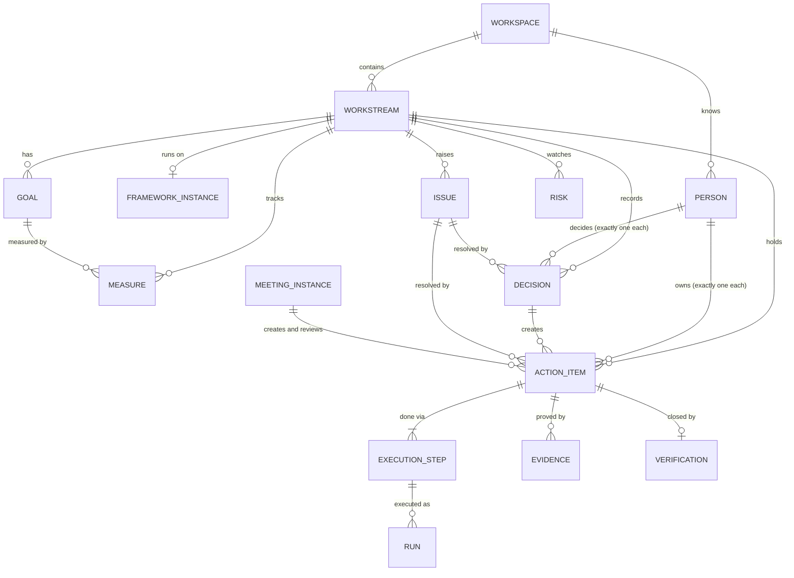
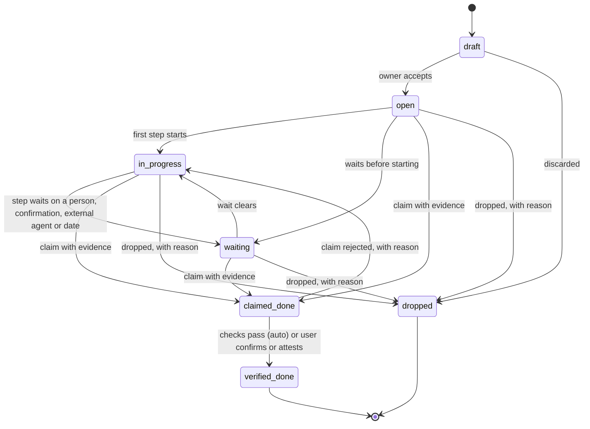
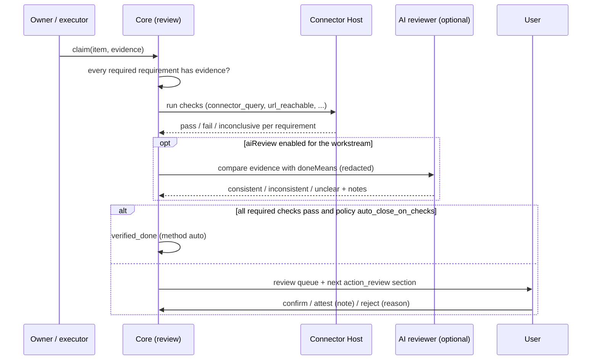

# 03 · Decisions and action items

- **Purpose:** Defines the data model (workstreams, people, goals, measures, decisions, issues, risks, action items, execution plans, evidence, verification), the state machines that move these records, and the review loop that checks an item was actually done, not just marked done.
- **Depends on:** [README.md](README.md) (ID, time, actor and risk-class conventions). Framework instances come from [01](01-onboarding-and-frameworks.md). The meetings that create and review items come from [02](02-rhythm-and-calendar.md).
- **Related files:** [04](04-platform.md) (store, Policy Engine, confirmations, AI layer), [05](05-connectors.md) (connector actions used by execution steps and verification checks), [07](07-agent-friendly-design.md) (CLI and MCP surface over this model), [09](09-build-plan.md) (P1 builds manual execution and review; P2 adds connector checks; P3 adds agent steps).

## 1. Summary

1. Everything belongs to one **workspace** (one user) and, inside it, to one **workstream**. In the scenario these are Alderwick and Quillmarsh.
2. Commitments are carried by **Goal** (priority/rock, OKR objective or key result, WIG), **Decision**, **ActionItem** and **Issue**, plus **Risk**.
3. Every action item has exactly one **owner**. The owner is an accountable person, never an AI agent or a connector. Every item also has a **due date**, a **definition of done** (`doneMeans`), **evidence requirements**, and an **execution plan**. The plan names how each step is performed: by the user, by another person, by a connector, by an AI agent inside CC, or by an external agent framework such as firstmate.
4. Items follow a lifecycle state machine (§7). There are only two exits: `verified_done`, and `dropped` with a reason.
5. "Done" is a claim. **Verification** turns the claim into a closed item, in one of three ways: deterministic checks through connectors (`auto`), the user confirming after reviewing the evidence (`confirmed`), or the user attesting where no machine-checkable evidence exists (`attested`, counted separately in metrics).
6. Every change is an append-only **domain event** with an actor. Current state is a projection kept in the same transaction.

## 2. Scope and non-goals

- In scope: types, invariants, state machines, execution semantics, the review loop, persistence layout, worked scenario examples.
- Non-goals: UI layout; agenda mechanics ([02](02-rhythm-and-calendar.md)); connector internals ([05](05-connectors.md)); multi-user collaboration. CC has one user, and other people are `Person` records (OQ-03-01).

## 3. Common conventions

These are restated from the index so this file stands alone.

```ts
/** `<prefix>_<ULID>`. Examples in these docs use readable placeholders such as `ws_ald`. */
type Id<P extends string> = `${P}_${string}`;
type WorkspaceId = Id<'wsp'>;         type PersonId = Id<'per'>;
type WorkstreamId = Id<'ws'>;         type FrameworkInstanceId = Id<'fwi'>;
type GoalId = Id<'goal'>;             type MeasureId = Id<'msr'>;
type DecisionId = Id<'dec'>;          type ActionItemId = Id<'act'>;
type IssueId = Id<'iss'>;             type RiskId = Id<'rsk'>;
type EvidenceId = Id<'evd'>;          type MeetingSeriesId = Id<'ser'>;
type MeetingInstanceId = Id<'mtg'>;   type ConnectorBindingId = Id<'bnd'>;
type RunId = Id<'run'>;               type AgentPrincipalId = Id<'agt'>;
type EventId = Id<'evt'>;             type SecretRef = Id<'sec'>;

/** Per-workspace counters, used in meetings and the CLI: A-0142, D-0007, I-0012, R-0002, M-0031, G-0004, K-0009. */
type HumanRef = string;

type UtcTimestamp = string;   // RFC 3339 in UTC, e.g. "2026-11-13T09:30:00Z"
type LocalDate = string;      // "2026-11-13", read in the owning workstream's time zone
type IanaTimeZone = string;   // "Asia/Kolkata"

type Actor =
  | { kind: 'user' }                                                     // the workspace user, acting in the app UI only (04 §4.3)
  | { kind: 'agent'; principalId: AgentPrincipalId; runId?: RunId }      // AI, CLI or MCP caller (always a principal)
  | { kind: 'connector'; bindingId: ConnectorBindingId; runId: RunId }
  | { kind: 'system'; component: 'rhythm' | 'review' | 'escalation' | 'ingest' | 'scheduler' | 'migration' };

interface Audit {
  createdAt: UtcTimestamp; createdBy: Actor;
  updatedAt: UtcTimestamp; updatedBy: Actor;
  version: number;              // optimistic concurrency; incremented on every write
}

type Health = 'on_track' | 'at_risk' | 'off_track';
type Privacy = 'normal' | 'sensitive';
```

## 4. Entity overview



## 5. Types

### 5.1 Workspace and Person

```ts
interface Workspace extends Audit {
  id: WorkspaceId;
  displayName: string;
  timeZone: IanaTimeZone;
  selfPersonId: PersonId;
  counters: Record<'A' | 'D' | 'I' | 'R' | 'M' | 'G' | 'K', number>; // next HumanRef numbers
}

interface Person extends Audit {
  id: PersonId;
  displayName: string;
  role: 'self' | 'collaborator' | 'external';  // self = the user; collaborator = e.g. a contractor; external = e.g. a client contact
  emails: string[];
  timeZone?: IanaTimeZone;
  consents: Consent[];          // what this person agreed the user may do on their behalf
}

interface Consent {
  scope: 'track_my_search' | 'draft_on_my_behalf' | 'read_my_alert_mailbox' | 'contact_me' | string;
  grantedAt: UtcTimestamp;
  recordedBy: Actor;            // the user, recording what the person said
  evidenceNote: string;         // e.g. "Asked in a WhatsApp message on 2026-11-02"
  revokedAt?: UtcTimestamp;
}
```

### 5.2 Workstream

```ts
type WorkstreamKind = 'company' | 'business_unit' | 'client_engagement' | 'project' | 'job_search' | 'personal' | 'other'
                    | 'workspace';     // the Workspace pseudo-workstream only (below); never offered at onboarding S2

interface Workstream extends Audit {
  id: WorkstreamId;
  slug: string;                 // "alderwick", unique in workspace, used by the CLI
  name: string;
  kind: WorkstreamKind;
  parentId?: WorkstreamId;
  principalId: PersonId;        // whose outcome: self, or another person
  stewardId: PersonId;          // who runs it in CC: always the user in v1
  timeZone: IanaTimeZone;
  status: 'active' | 'paused' | 'archived';
  frameworkInstanceId?: FrameworkInstanceId;    // absent when inheriting from the parent (01 rule R5)
  privacy: Privacy;
  aiDataPolicy: 'allow' | 'redact_people' | 'deny';
  repoPaths: string[];          // local git repos mapped to this workstream (ambient context, 07)
  groundingRefs: { kind: 'profile' | 'rubric' | 'writing_style' | 'master_resume'; path: string }[]; // job search
}
```

**The Workspace pseudo-workstream** (owner decision Q4, 10 Nov 2026). Every workspace has exactly one workstream of kind `workspace`, named "Workspace", with slug `workspace`. It is created at the onboarding commit, holds workspace-level risks (for example a risk to the backups or to the machine, which belongs to no single workstream), and the issues and action items they lead to. It has no framework instance, no meetings and no measures, is never archived, and is not listed among the workstreams at onboarding S2. Its principal and steward are the user, its time zone is the workspace's, and its privacy is `normal`. Which meeting reviews its risks is open (OQ-03-06).

### 5.3 Goal

```ts
type GoalKind = 'vision' | 'annual' | 'priority' | 'objective' | 'key_result' | 'wig' | 'personal_goal';

interface Goal extends Audit {
  id: GoalId;
  ref: HumanRef;                // "G-0004"
  workstreamId: WorkstreamId;
  frameworkInstanceId: FrameworkInstanceId;
  kind: GoalKind;               // eos-lite: priority; okr: objective/key_result; 4dx: wig; personal-os: personal_goal
  title: string;
  ownerId: PersonId;            // exactly one
  parentId?: GoalId;            // key_result -> objective; priority -> annual
  period: { start: LocalDate; end: LocalDate; label: string };   // "2026-Q4"
  doneMeans?: string;
  measureIds: MeasureId[];
  target?: { from: number; to: number; unit: string; by: LocalDate };  // WIG: "from X to Y by when"
  commitment: 'committed' | 'aspirational';                          // okr only; others 'committed'
  status: 'active' | 'done' | 'not_done' | 'dropped';
  health: Health;
  healthNote?: string;
  grade?: number;               // priority/rock: 1 or 0; okr: 0.0-1.0; wig: lag value at target.by
}
```

**Goals are editable any time** (owner decision Q2, 10 Nov 2026), not only in a meeting: on the **Goals tab of the Scorecard screen** ([09 §6.1](09-build-plan.md#61-ordered-build-steps), P1-11). Every change is logged: like every write, it appends a `goal.*` domain event with the changed fields before and after and the actor (INV-03-09), and the Goals tab shows each goal's history. The template's invariants still run on every change (C-01-03), for example the goal count of PO-2, X-1 or E-3.

### 5.4 Measure and MeasureValue

```ts
interface Measure extends Audit {
  id: MeasureId;
  ref: HumanRef;                // "K-0001"
  workstreamIds: WorkstreamId[];  // usually one; K-0006 spans the merged review
  name: string;
  ownerId: PersonId;
  unit: 'count' | 'percent' | 'currency' | 'hours' | 'boolean' | 'days';
  currency?: string;            // ISO 4217, e.g. "INR"
  role: 'lead' | 'lag';         // 4DX lead/lag; Amazon's controllable input/output
  cadence: 'daily' | 'weekly' | 'monthly' | 'quarterly';
  aggregation: 'sum' | 'last' | 'avg' | 'max' | 'min';
  target: { op: 'gte' | 'lte' | 'eq' | 'between'; value: number | boolean; value2?: number };
  source:
    | { kind: 'manual' }
    | { kind: 'connector'; bindingId: ConnectorBindingId; action: string; input: Record<string, unknown>; valuePath: string }
    | { kind: 'derived'; formula: 'action_items_closed_on_time_pct' | 'verified_items_count' | 'meetings_held_pct' };
  scorecardOrder: number;
  active: boolean;
}

interface MeasureValue {
  id: string;
  measureId: MeasureId;
  periodStart: LocalDate;       // start of the week/month/quarter in the measure's time zone
  value: number | boolean;
  source: 'manual' | 'connector' | 'derived';
  recordedAt: UtcTimestamp;
  recordedBy: Actor;
  normal: boolean | null;       // set in the scorecard section: normal / not normal / not yet read
  note?: string;                // required when normal === false
}
```

### 5.5 Decision

```ts
type DecisionStatus = 'proposed' | 'open' | 'decided' | 'superseded' | 'reversed' | 'dropped';

interface Decision extends Audit {
  id: DecisionId;
  ref: HumanRef;                // "D-0008"
  workstreamId: WorkstreamId;
  question: string;             // phrased as a question
  deciderId: PersonId;          // exactly one, always a person (RAPID "D", DACI "Approver")
  driverId?: PersonId;          // recommends and drives
  inputFromIds: PersonId[];     // voice, no veto
  informIds: PersonId[];
  reversibility: 'two_way' | 'one_way';
  dueBy?: LocalDate;
  options: { id: string; text: string; proposedBy: Actor }[];
  recommendation?: { optionId: string; rationale: string; by: Actor };   // agents may recommend
  outcome?: { optionId?: string; text: string; why: string; decidedAt: UtcTimestamp; resourcesCommitted?: string };
  actionItemIds: ActionItemId[];
  reviewOn?: { date?: LocalDate; trigger?: string };
  supersedesId?: DecisionId;
  memoSha256?: string;          // one- or two-page memo for one-way doors (blob store)
  source: ItemSource;
  status: DecisionStatus;
  dropReason?: string;          // required for dropped (§10 rule 1)
}
```

Fields follow the decision record in `regime/ceo-operating-cadence.md` §5.4. Roles come from RAPID and DACI, the door test from Bezos, and "resources committed" from Mankins.

### 5.6 Issue and Risk

```ts
interface Issue extends Audit {
  id: IssueId;
  ref: HumanRef;                // "I-0012"
  workstreamId: WorkstreamId;
  title: string;
  raisedFrom:
    | { kind: 'meeting'; meetingId: MeetingInstanceId; sectionId: string }
    | { kind: 'escalation'; actionItemId: ActionItemId; level: 2 }
    | { kind: 'goal_off_track'; goalId: GoalId }
    | { kind: 'measure_not_normal'; measureId: MeasureId; periodStart: LocalDate }
    | { kind: 'rhythm'; seriesId: MeetingSeriesId }
    | { kind: 'manual' };
  rank?: number;                // set in the issues section; lower is more important
  status: 'open' | 'resolved' | 'dropped';
  resolution?: { kind: 'decision' | 'action' | 'replan' | 'dropped'; refs: string[]; note: string; at: UtcTimestamp; by: Actor };
}

interface Risk extends Audit {
  id: RiskId;
  ref: HumanRef;                // "R-0002"
  workstreamId: WorkstreamId;
  description: string;          // "Client renewal: if no PO by 15 Dec, move build time to product"
  watcherId: PersonId;
  trigger: string;
  status: 'watching' | 'triggered' | 'closed';
  reviewCadence: 'monthly';
}
```

### 5.7 ActionItem

```ts
type ActionKind = 'todo' | 'follow_up';       // follow_up = find something out and report back
type Lifecycle = 'draft' | 'open' | 'in_progress' | 'waiting' | 'claimed_done' | 'verified_done' | 'dropped';

type ItemSource =
  | { kind: 'meeting'; meetingId: MeetingInstanceId; sectionId: string }
  | { kind: 'decision'; decisionId: DecisionId }
  | { kind: 'issue'; issueId: IssueId }
  | { kind: 'template'; templateId: string; recurrenceKey: string }   // pack recurring items, e.g. "2026-W47"
  | { kind: 'agent_suggestion'; runId: RunId }                        // always starts as draft
  | { kind: 'ingest_rule'; bindingId: ConnectorBindingId; recordId: string } // always starts as draft
  | { kind: 'manual' };

interface ActionItem extends Audit {
  id: ActionItemId;
  ref: HumanRef;                // "A-0142"
  workstreamId: WorkstreamId;
  kind: ActionKind;
  title: string;                // verb + deliverable, at most 120 characters
  doneMeans: string;            // what a stranger could check
  evidenceRequirements: EvidenceRequirement[];
  verificationPolicy: 'require_review' | 'auto_close_on_checks';
  ownerId: PersonId;            // exactly one accountable person
  reviewerId: PersonId;         // who confirms; default the user
  informIds: PersonId[];        // "tell when done"
  due: { date: LocalDate; time?: string; timeZone: IanaTimeZone };
  lifecycle: Lifecycle;
  health: Health;
  healthNote?: string;
  waitingOn?: { kind: 'person' | 'confirmation' | 'external_agent' | 'dependency' | 'date'; ref?: string; since: UtcTimestamp };
  execution: ExecutionPlan;
  source: ItemSource;
  links: { goalIds: GoalId[]; measureIds: MeasureId[]; decisionIds: DecisionId[]; issueIds: IssueId[]; parentActionId?: ActionItemId };
  carryCount: number;           // see 02 §7.1
  replannedCount: number;
  escalationLevel: 0 | 1 | 2 | 3 | 4;
  claim?: { at: UtcTimestamp; by: Actor; note?: string };
  verification?: VerificationRecord;
  dropReason?: string;
  closedAt?: UtcTimestamp;
  closedBy?: Actor;
  privacy: Privacy;             // inherits from the workstream; may only be raised
  externalRefs: ExternalRef[];
}

type ExternalRef =
  | { system: 'firstmate'; home: string; taskId: string }
  | { system: 'github'; url: string }
  | { system: 'calendar'; bindingId: ConnectorBindingId; eventId: string }
  | { system: 'other'; label: string; url?: string };
```

### 5.8 Execution plan

```ts
type AgentProfileId = 'drafter' | 'extractor' | 'planner' | 'reviewer' | 'summarize' | 'tailor' | 'discoverer'; // 04 §6.4

type Performer =
  | { kind: 'user' }                                         // the CC user does it by hand
  | { kind: 'person'; personId: PersonId }                   // someone else (a client contact, a contractor)
  | { kind: 'connector'; bindingId: ConnectorBindingId; action: string; input: Record<string, unknown> }
  | { kind: 'agent'; profile: AgentProfileId; instructions: string; tools: string[]; budget: AgentBudget }
  | { kind: 'external_agent'; system: 'firstmate' | 'grok' | 'other'; principalId?: AgentPrincipalId; handoff: string };

interface AgentBudget { maxUsd: number; maxMinutes: number; maxToolCalls: number }

type StepStatus =
  | 'pending'                 // dependencies not met
  | 'ready'                   // can start
  | 'running'
  | 'waiting_confirmation'    // a ConfirmationRequest is pending (04 §7)
  | 'waiting_user'            // a user step, or a browser session needing the user
  | 'waiting_external'        // a person or an external agent is doing it
  | 'succeeded' | 'failed' | 'skipped';

interface ExecutionStep {
  id: string;                 // "s1"
  order: number;
  title: string;
  performer: Performer;
  dependsOn: string[];
  satisfies: string[];        // evidence requirement IDs this step is expected to produce
  confirmation: 'policy' | 'always';   // 'always' can only make the Policy Engine stricter
  status: StepStatus;
  runIds: RunId[];
  output?: { evidenceIds: EvidenceId[]; note?: string };
  failure?: { at: UtcTimestamp; code: string; detail: string; retriable: boolean };
}

interface ExecutionPlan {
  mode: 'manual' | 'connector' | 'agent' | 'mixed';   // derived (§8.3), never set by hand
  steps: ExecutionStep[];
}

interface Run {
  id: RunId;
  kind: 'connector_action' | 'connector_sync' | 'agent' | 'verification' | 'discovery';
  actionItemId?: ActionItemId;
  stepId?: string;
  startedAt: UtcTimestamp; endedAt?: UtcTimestamp;
  status: 'running' | 'succeeded' | 'failed' | 'needs_user' | 'cancelled';
  actor: Actor;
  usage?: { provider: string; model: string; inputTokens: number; outputTokens: number; usd: number };
  logSha256?: string;         // redacted structured log in the blob store
}
```

### 5.9 Evidence and verification

```ts
type EvidenceKind = 'url' | 'file' | 'note' | 'connector_record' | 'measure_value' | 'meeting_record' | 'external_task';

interface EvidenceRequirement {
  id: string;                 // "er1"
  description: string;        // "Blog post is live at a public URL"
  required: boolean;
  acceptedKinds: EvidenceKind[];
  check?: VerificationCheck;  // deterministic, optional
}

/** Dot path into a JSON value: `posts[0].status`, `messages.length`. */
type Predicate =
  | { path: string; op: 'eq' | 'neq' | 'gt' | 'gte' | 'lt' | 'lte' | 'contains' | 'matches' | 'exists'; value?: unknown }
  | { all: Predicate[] }
  | { any: Predicate[] };

type VerificationCheck =
  | { type: 'connector_query'; bindingId: ConnectorBindingId; action: string; input: Record<string, unknown>;
      expect: Predicate; notBefore?: UtcTimestamp; retry: { attempts: number; intervalMinutes: number } }
  | { type: 'url_reachable'; url: string; expectStatus: number[]; expectText?: string }
  | { type: 'measure_threshold'; measureId: MeasureId; periodStart: LocalDate; expect: Predicate }
  | { type: 'external_task_state'; system: 'firstmate'; taskId: string; expect: 'pr_ready' | 'merged' }
  | { type: 'child_items'; expect: 'all_verified' };

interface Evidence {
  id: EvidenceId;
  actionItemId: ActionItemId;
  requirementId?: string;
  kind: EvidenceKind;
  summary: string;            // at most 200 characters
  url?: string;
  blobSha256?: string;        // files and screenshots, content-addressed
  record?: { bindingId: ConnectorBindingId; recordType: string; externalId: string };
  externalTask?: { system: 'firstmate'; home: string; taskId: string; pr?: string };
  capturedAt: UtcTimestamp;
  capturedBy: Actor;
}

interface CheckResult {
  requirementId: string;
  status: 'pass' | 'fail' | 'inconclusive' | 'pending';
  at: UtcTimestamp;
  detail: string;             // e.g. "1 sent message matched"
  runId?: RunId;
  evidenceId?: EvidenceId;
}

type VerificationMethod = 'auto' | 'confirmed' | 'attested';

/** Exists from the first claim: it holds the queued and finished check results while the item
 *  waits for review, and the rejected claims. method, decidedBy and decidedAt are set together
 *  when the item is verified, and only then (INV-03-06). */
interface VerificationRecord {
  method?: VerificationMethod;
  checks: CheckResult[];
  aiReview?: { runId: RunId; verdict: 'consistent' | 'inconsistent' | 'unclear'; notes: string };  // advisory only
  decidedBy?: Actor;          // system:review for auto; user for confirmed/attested
  decidedAt?: UtcTimestamp;
  attestationNote?: string;   // required for attested
  rejectedClaims: { at: UtcTimestamp; by: Actor; reason: string }[];
}
```

### 5.10 Domain events

```ts
interface DomainEvent {
  id: EventId;                // ULID, so event order equals ID order
  at: UtcTimestamp;
  actor: Actor;
  type: string;               // "<entity>.<verb>", e.g. "action_item.claimed", "decision.decided"
  entity: { kind: string; id: string; ref?: HumanRef };
  before?: unknown;           // changed fields only
  after?: unknown;
  correlationId?: string;     // meeting instance, run, or confirmation that caused it
}
```

Event types outside the record model proper, written in the same transaction as their state change:

- `development_request.<status>` for each transition of a development request, from `draft` to `active` or `rolled_back`, including `approved`, `rejected` and `deferred` from the review screen ([06 §10.4](06-connector-discovery.md#104-development-requests)).
- `connector.activated`, `connector.rolled_back` and `connector.disabled` from the lock loader ([05 §15.6](05-connectors.md#156-connectorslock-and-the-users-own-connectors)).
- `backup.completed`, `backup.failed`, `backup.restore_tested` and `backup.restored` ([04 §9.1](04-platform.md#91-backups)).
- `agent_principal.created`, `agent_principal.updated`, `agent_principal.revoked` and `agent_principal.used` for agent principals ([07 §5](07-agent-friendly-design.md#5-agent-principals-and-scopes)). The events carry the changed fields and never a token.
- `workspace.counter_advanced` when a command takes the next HumanRef of a kind (§5.1), in the same transaction as the record that uses it.
- `action_item.due_proposed` when an agent proposes a due change (`items update --propose-due`, [07 §4.2](07-agent-friendly-design.md#42-commands)). It changes no field of the item: `after` holds the current `due`, the `proposedDue` and the `reason`, and the proposal waits in the item's history (C-03-04) for the user to re-plan (owner decision, 12 Nov 2026).

## 6. Invariants

Each is enforced in the core service on every write. A violation returns `E_INVARIANT` with the ID.

1. **INV-03-01** An action item has exactly one `ownerId`, and it references a `Person`. Agents and connectors are never owners.
2. **INV-03-02** `Decision.deciderId` references a `Person`. An agent may propose options and a recommendation, but never decides.
3. **INV-03-03** `healthNote` is required when `health` is not `on_track`. The same holds for goals.
4. **INV-03-04** An item outside `draft` has a non-empty `title`, `doneMeans` and `due`, and at least one evidence requirement with `required = true`.
5. **INV-03-05** `dropped` requires `dropReason`. Records are never hard-deleted. The only exception is a user-initiated workspace purge (OQ-03-03).
6. **INV-03-06** `verified_done` requires a `VerificationRecord`. For `auto`, every required requirement has a `pass` check, and `verificationPolicy` is `auto_close_on_checks`. For `confirmed` or `attested`, `decidedBy.kind == 'user'`. `attested` requires `attestationNote`.
7. **INV-03-07** Only an actor of kind `user` can set `confirmed` or `attested`, reject a claim, decide a decision, or drop an item another actor created. Agents and connectors can only add evidence, run checks, and claim (when the principal has scope `items:claim`).
8. **INV-03-08** An `agent` step has a `budget` and a tool allowlist. A `connector` step names an action that exists in the bound connector's installed manifest. Its risk class comes from that manifest, never from the step.
9. **INV-03-09** Every write appends exactly one `DomainEvent` in the same SQLite transaction.
10. **INV-03-10** `privacy = 'sensitive'` content (in the scenario, the confidential item A-0152) never appears in calendar event text, and is sent to AI providers only under the workstream's `aiDataPolicy` (04 §6.5).
11. **INV-03-11** A resolved issue references at least one decision or action item, or has resolution kind `replan` or `dropped` with a note.
12. **INV-03-12** Framework validators may add rules, for example eos-lite E-4: a `todo` is due at most `todoHorizonDays` after creation unless it links to a goal. They run on every write that touches the item.

## 7. Action-item lifecycle



| From → To | Trigger | Allowed actors | Guards | Side effects |
|---|---|---|---|---|
| `draft` → `open` | accept | user (also on behalf of an external owner, with note). Items created through the CLI or MCP always start as `draft` | INV-03-04 | event; first step becomes `ready` |
| `open` → `in_progress` | a step starts | system:scheduler, user | none | event |
| any open state → `waiting` | a step enters `waiting_*` | system | `waitingOn` set | E1 timer counts from `since` |
| any open state → `claimed_done` | claim | user; agent with `items:claim`; system:review when a step completes all required evidence | every required requirement has at least one evidence record | auto-checks are queued (§9.2 step 2) |
| `claimed_done` → `verified_done` | verification | system:review (auto); user (confirmed, attested) | INV-03-06 | `closedAt`; inform drafts; the measure K-0006 is recomputed |
| `claimed_done` → `in_progress` | reject | user | reason required | `rejectedClaims` appended; health `at_risk` |
| any open state → `dropped` | drop | user | `dropReason` | the linked issue is resolved if this was its last open action: kind `action`, with the refs of all its action items and a note naming the drop |

Health rules:

1. The owner or user may set health at any time, with a note.
2. The escalation job (02 §7.2) sets `off_track` when the due date has passed and the item is not claimed. It sets `at_risk` when a step failed or a wait has lasted longer than 3 days.
3. The system never sets `on_track` over a user-set `at_risk` or `off_track`. Only the user clears these, or a claim that is then verified. Since a record does not keep who set its health, this is enforced as: no actor but the user lowers health (`on_track` < `at_risk` < `off_track`); the system and agents only raise it, and a verification sets `on_track`.

## 8. Execution

### 8.1 Performers

| Performer | Who acts | How it runs | Evidence it produces |
|---|---|---|---|
| `user` | The CC user | Appears in the user's task list and the daily start. The user marks the step done and may attach evidence. | Whatever the user attaches |
| `person` | Another person (a client contact, a contractor) | `waiting_external`. CC may prepare a nudge draft (E0/E1), and sending it needs confirmation. The user records completion. | User-recorded notes, or forwarded confirmations ingested by a connector |
| `connector` | A connector action | Connector Host `invoke` after the Policy Engine check ([04 §7](04-platform.md#7-policy-engine-and-confirmations)). It may produce a `ConfirmationRequest` and wait. | The connector output, saved as a `connector_record` evidence |
| `agent` | A CC agent profile through the AI layer | The orchestrator runs the profile with the step's instructions, tool allowlist and budget ([04 §6](04-platform.md#6-ai-layer-providers-and-agent-profiles)). | Drafts, files, notes, records created through allowed tools |
| `external_agent` | An agent framework outside CC (firstmate, Grok bots) | CC prepares a handoff brief. The user hands it over. CC tracks progress through the framework's documented records ([07 §6](07-agent-friendly-design.md#6-agent-framework-integration)). | `external_task` evidence (for example a PR URL) |

### 8.2 Step runner

1. A step becomes `ready` when all `dependsOn` steps have `succeeded` or been `skipped`.
2. `ready` connector and agent steps start automatically, unless the item is `draft` or the step's workstream is `paused`. User and person steps wait for a human.
3. A connector action is retried only if its manifest declares it `idempotent`. Then up to 3 attempts are made with exponential backoff (1, 5, 25 minutes). Non-idempotent failures go to `failed` at once.
4. A `failed` step sets item health to `at_risk` with the failure code as the note, and notifies the user only when the next step needs the user (02 §10).
5. Agent steps that exceed their `budget` stop with code `E_BUDGET`. Partial outputs are kept as draft evidence.
6. When every step that `satisfies` a required evidence requirement has succeeded, the system claims the item (actor `system:review`).

### 8.3 Mode derivation

| Steps contain | `mode` |
|---|---|
| only `user` or `person` | `manual` |
| only `connector` | `connector` |
| `agent` or `external_agent`, and no `user`, `person` or `connector` | `agent` |
| anything else | `mixed` |

### 8.4 Action templates

Packs (01 §5.5) define reusable templates so that items are consistent:

```ts
interface ActionTemplate {
  id: string;                       // "tpl.marketing.linkedin-batch"
  title: string;                    // "{{workstream}} LinkedIn batch, week {{isoWeek}}"
  kind: ActionKind;
  doneMeans: string;
  evidenceRequirements: EvidenceRequirement[];   // checks may reference binding roles, see below
  verificationPolicy: ActionItem['verificationPolicy'];
  steps: Omit<ExecutionStep, 'status' | 'runIds' | 'output' | 'failure'>[];
  bindingRoles: Record<string, { category: string; connectorIds: string[] }>; // e.g. { mail: {category: "email", ...} }
  defaultDueOffsetDays: number;
}
```

`bindingRoles` are resolved to concrete `ConnectorBinding` IDs of the workstream when the item is created. If a role cannot be resolved, the step falls back to a `user` step, and a note names the missing connector.

### 8.5 Team task trackers (owner decision C2)

Owner decision C2 (10 Nov 2026) adds a team task tracker: an on-demand connector, Google Sheets first, then Jira or Linear ([05 §16](05-connectors.md#16-onboarding-tool-selection-step-s7-and-the-reference-scenario) item 4). **The design is still silent on how tracker tasks relate to CC's action items** (OQ-03-05). The current rules fix only this much:

1. A connector record becomes an action item only as a **draft** (`ItemSource` kind `ingest_rule`, §5.7; [05 §11](05-connectors.md#11-records-and-ingest) rule 3), which the user accepts. The item still has exactly one owner who is a person, a done-means and evidence (INV-03-01, INV-03-04).
2. An action item can already point at a tracker task with an `ExternalRef` of system `other`.
3. A tracker task's state can count as evidence only through a deterministic check on the tracker binding (`connector_query`, §9.1). It never closes an item by itself under `require_review` (§9.4).

Not settled: whether every tracker task becomes an action item or only the ones the user picks; whether CC writes items back to the tracker; which side is the source of truth for status, owner and due date; and whether `ExternalRef` and the record types gain a tracker system and a `task@1` record.

## 9. Evidence and the review loop

### 9.1 Requirements

1. Requirements come from the template, or are written by the user, or are drafted by the `planner` profile and accepted by the user.
2. A requirement with a `check` can pass automatically. A requirement without one needs the user's confirmation or attestation.
3. Default requirement per common item type:

| Item type | Default requirement and check |
|---|---|
| Send an email | `connector_query` on the mail binding: a sent message to the recipient with the subject, after the item was created |
| Publish a blog post | `connector_query` on the CMS binding: post status `publish`, and `url_reachable` on the post URL after the publish time |
| Publish social posts | `connector_query` on the social binding: N posts in the date window whose text hash matches approved drafts |
| Ship code | `external_task_state` merged, or `connector_query` on the GitHub binding: PR merged |
| Hold a call or meeting | `connector_query` on the calendar: the event exists and is in the past (weak; usually paired with a note) |
| Record a number | `measure_threshold` on the measure for the period |
| Anything else | `note` or `file` evidence and user confirmation |

### 9.2 The loop



Steps:

1. **Claim.** Any of the actors in §7 claims the item with evidence. A claim without evidence for each required requirement is refused (`E_EVIDENCE_MISSING`, listing the requirement IDs).
2. **Auto-check.** Every requirement with a `check` runs, respecting `notBefore` (for example the scheduled publish time) and `retry`. `inconclusive` means the check could not run (connector down, session signed out). It is never treated as `pass`.
3. **AI review (advisory).** If enabled, the `reviewer` profile compares the evidence with `doneMeans` and returns a verdict and notes, for example "the blog post is published but does not link to the free consultation offer, which the done-means requires". It never changes the lifecycle (firstmate: "Evidence is never authorization", [07 §2](07-agent-friendly-design.md#2-sources-read)).
4. **Decide.**
   - `auto_close_on_checks` and every required check passes: `verified_done` with method `auto`. The item is still listed under "auto-verified since last review" in the next `action_review` for a spot check.
   - Otherwise the item waits in the review queue and in the next meeting's `action_review`. The user confirms, attests with a note, or rejects with a reason.
   - **Confirm needs checkable evidence** (owner decision Q5, 10 Nov 2026). **Confirm** is enabled only when every required requirement has evidence the user can check: a `pass` check result, or evidence of kind `url`, `file`, `connector_record`, `measure_value`, `meeting_record` or `external_task` (§5.9). A requirement backed only by a `note` leaves Confirm disabled, with the reason shown, and **Attest** is offered instead. Attested items are counted separately (§9.3, §9.6). This reading of "checkable" (anything but a bare note) is the design's.
5. **Reject.** Back to `in_progress`, health `at_risk`, `rejectedClaims` appended. The item keeps carrying forward.

### 9.3 Methods and assurance

| Method | Meaning | Counted as |
|---|---|---|
| `auto` | Every required deterministic check passed | verified |
| `confirmed` | The user reviewed the evidence and confirmed it | verified |
| `attested` | The user states it was done, with no checkable evidence. The only method offered when the evidence is not checkable (§9.2 step 4) | done, reported separately |

### 9.4 Verification policies

- `require_review` (the default): closing always needs the user.
- `auto_close_on_checks`: allowed only if every required requirement has a deterministic check, and only for templates the user opted in for at tailoring (Q-T07). In the scenario defaults, this covers calendar-event and measure-threshold checks only.

### 9.5 Evidence decay

Requirements may declare `recheckAfterDays` (in the template). For example, a post must still be live 7 days later. The recheck runs once. A failure does not reopen history. It creates a new `follow_up` item linked to the original, with source `{ kind: 'issue' }` from an auto-raised issue.

### 9.6 Metrics

These are derived nightly and shown in `register_health` (02 §5.2):

- Closed on time: `verified_done` with `closedAt` on or before the due date, over all closed or overdue items in the window. This is measure K-0006. Each item counts once, in the window that holds its due date (read in the item's time zone): the items due in the window that are verified, or overdue (past due and not claimed, as in [07 §4.3](07-agent-friendly-design.md#43-output-examples)), at the time of the computation. An item claimed and waiting for review, or not yet due, is not counted yet; a dropped item is not counted. Attested items count as closed (OQ-03-02 default).
- Verified share: (`auto` + `confirmed`) over all `verified_done`. Attested items are reported separately.
- Rejected claims in the window.
- Items rolled over twice or more (`carryCount >= 2`), and the oldest open item.

## 10. Decisions

1. Lifecycle: `proposed` (agent or user drafted) → `open` (accepted onto the agenda, decider set) → `decided` → optionally `superseded` (by a later decision) or `reversed`. `dropped` needs a reason.
2. Only the decider (a person) moves `open` → `decided`. In solo mode, that is the user.
3. `one_way` decisions need a memo blob, or a waiver note if `decision.memoForOneWayDoors` is false. The waiver note has no field of its own: it is kept in the `decision.decided` event. They are put on the monthly or quarterly agenda unless the user overrides that.
4. Deciding creates the action items listed in the outcome in the same transaction. Each has `source = { kind: 'decision' }`.
5. `reviewOn` creates a `follow_up` item for the decider, due on that date, or an ingest rule for a trigger.

## 11. Issues and risks

1. Issues come from meetings, E2 escalations, goals off track twice, not-normal measures with no explanation, and rhythm escalations (02 §4.2).
2. The `issues` section resolves them by IDS (identify, discuss, solve). Each ends as a decision, as one or more action items, as a re-plan (an action item gets a new due date and reason), or as a drop (INV-03-11).
3. Risks are reviewed monthly in `risk_review`. A triggered risk creates an issue.
4. A risk that belongs to the whole workspace, not to one workstream, is recorded on the Workspace pseudo-workstream (§5.2; owner decision Q4, 10 Nov 2026).

## 12. Persistence

1. **Store:** one SQLite database per workspace (WAL mode) in the app data directory ([04 §9](04-platform.md#9-storage-secrets-and-data-location)). Blobs (files, memos, pre-reads, screenshots) live in a content-addressed directory, `blobs/<sha256[0:2]>/<sha256>`.
2. **Tables:** `workspace`, `persons`, `workstreams`, `framework_instances`, `goals`, `measures`, `measure_values`, `decisions`, `issues`, `risks`, `action_items`, `execution_steps`, `runs`, `evidence`, `verifications`, `meeting_series`, `meeting_instances`, `connector_installs`, `connector_bindings`, `browser_sessions`, `confirmations`, `standing_approvals`, `agent_principals`, `development_requests`, `backup_runs`, `onboarding` (the onboarding answers, [01 §9.1](01-onboarding-and-frameworks.md#91-where-answers-live); P1-12, migration 0003), `events`. Plus `fts_items`, an FTS5 index over titles, done-means and notes.
3. **Columns:** scalar fields as columns, nested structures as JSON columns validated by the same schemas as the API. Every table has `version` for optimistic concurrency.
4. **Writes:** only through the core repository layer, one transaction per command (`BEGIN IMMEDIATE`). Each transaction writes the projection rows and the `events` rows. A write with a stale `version` fails with `E_CONFLICT`.
5. **Migrations:** numbered forward-only SQL files (`packages/store/migrations/NNNN_name.sql`) with a `schema_version` table. Each migration has a fixture test that upgrades a snapshot of the previous schema.
6. **Export:** `cc-axi export --out <dir>` writes one JSONL file per table plus blobs, with a manifest of hashes. Export never includes secrets. Because an export holds every record (C-03-06), the local API's `export.run` runs only for the user or for an agent principal that sees every workstream, sensitive ones included ([07 §5](07-agent-friendly-design.md#5-agent-principals-and-scopes)); it writes to an absolute directory.

## 13. Worked examples (reference scenario)

### 13.1 A-0142: follow-up to a consulting lead (Alderwick, mixed)

```json
{
  "id": "act_a0142", "ref": "A-0142", "workstreamId": "ws_ald", "kind": "todo",
  "title": "Send revised proposal with phased pricing to the consulting lead",
  "doneMeans": "The revised proposal is sent from the Alderwick mailbox to the lead and filed in the client folder.",
  "evidenceRequirements": [
    { "id": "er1", "description": "Sent message to the lead with the proposal attached", "required": true,
      "acceptedKinds": ["connector_record"],
      "check": { "type": "connector_query", "bindingId": "bnd_gmail_ald", "action": "search_messages",
                 "input": { "query": "in:sent to:{{lead.email}} subject:\"Revised proposal\" after:2026-11-10" },
                 "expect": { "path": "messages.length", "op": "gte", "value": 1 },
                 "retry": { "attempts": 3, "intervalMinutes": 30 } } }
  ],
  "verificationPolicy": "require_review",
  "ownerId": "per_self", "reviewerId": "per_self", "informIds": [],
  "due": { "date": "2026-11-12", "timeZone": "Asia/Kolkata" },
  "lifecycle": "waiting", "health": "on_track",
  "waitingOn": { "kind": "confirmation", "ref": "cfm_7q2", "since": "2026-11-11T10:05:00Z" },
  "execution": { "mode": "mixed", "steps": [
    { "id": "s1", "order": 1, "title": "Draft the email and attach the proposal", "dependsOn": [], "satisfies": [],
      "performer": { "kind": "agent", "profile": "drafter",
                     "instructions": "Draft a reply to the lead's last message using the revised proposal; save it as a Gmail draft.",
                     "tools": ["cc_get", "cc_connector_invoke:gmail-alderwick.create_draft"],
                     "budget": { "maxUsd": 0.5, "maxMinutes": 5, "maxToolCalls": 10 } },
      "confirmation": "policy", "status": "succeeded", "runIds": ["run_01"] },
    { "id": "s2", "order": 2, "title": "Review and send the draft", "dependsOn": ["s1"], "satisfies": ["er1"],
      "performer": { "kind": "connector", "bindingId": "bnd_gmail_ald", "action": "send_draft", "input": { "draftId": "{{s1.output.draftId}}" } },
      "confirmation": "always", "status": "waiting_confirmation", "runIds": [] }
  ] },
  "source": { "kind": "manual" },
  "links": { "goalIds": [], "measureIds": ["msr_k0003"], "decisionIds": [], "issueIds": [] },
  "carryCount": 0, "replannedCount": 0, "escalationLevel": 0, "privacy": "normal", "externalRefs": []
}
```

`create_draft` has risk class `write_external_draft` and runs without confirmation. `send_draft` has risk class `send_publish` and always produces a payload-bound confirmation that shows the recipients, subject and body. If the user sends the draft from Gmail directly instead, the user marks s2 done, and the check in er1 still verifies the send.

### 13.2 A-0160: Alderwick LinkedIn batch, week 47 (recurring template, mixed)

- Template `tpl.marketing.linkedin-batch`, recurrence `FREQ=WEEKLY;BYDAY=TH` (Alderwick batch day, `regime/plan.md` §4.1). Due Thu 2026-11-19.
- Steps:
  1. `agent:drafter` drafts 3 posts from the week's "what shipped" notes and the idea list. Drafts are saved as evidence files.
  2. `user` reviews and edits them in the content review. Approving creates confirmations bound to the approved text hashes (04 §7.4).
  3. `user` schedules the posts in LinkedIn's own scheduler (weeks 1 and 2). From week 3 this becomes a `connector` step on the scheduler binding chosen in D-0008.
- Requirement er1: `connector_query` on `bnd_linkedin_self`, action `list_recent_posts` (P4), expecting 3 or more posts between 2026-11-19 and 2026-11-26 whose `textHash` is in the approved set. `notBefore` is the last scheduled time. Until P4 ships, er1 has no check and the user confirms.

### 13.3 A-0152: the client contact signs the statement of work (Alderwick, person performer)

- Item "Sign the statement of work for phase two" in Alderwick (`ws_ald`), due 2026-11-20. The statement of work is confidential, so the item's privacy is `sensitive` although Alderwick's is `normal` (§5.7: an item may be more private than its workstream). Done-means: the client contact has signed the phase-two statement of work, shown by the countersigned copy in the Alderwick mailbox or the client contact's message.
- Owner: the client contact (`per_client`, role external, consent `contact_me`). Reviewer: the user. Privacy `sensitive`.
- Steps:
  1. `agent:drafter` drafts the statement of work from the engagement notes. It never invents scope, prices or dates.
  2. `user` reviews the draft.
  3. `connector` `gmail-alderwick.create_draft` drafts an email to the client contact with the statement of work.
  4. `user` sends it.
  5. `person` (the client contact) signs.
- Requirement er1: the statement of work is signed. Accepted kinds are a `connector_record` (the countersigned copy arriving in the Alderwick mailbox binding `bnd_gmail_ald`) or a `note` (the user attests, citing the client contact's message).

### 13.4 A-0144: fix the contact form on the Quillmarsh site (external agent)

- Performer: `external_agent` firstmate. Handoff brief: intent, done-means, evidence expectations, links ([07 §6](07-agent-friendly-design.md#6-agent-framework-integration)).
- Requirement er1: `external_task_state`, firstmate task `quillmarsh-contact-form`, expecting `merged`. It is cross-checked with `connector_query` on `bnd_github_main`, action `get_pull`, expecting `merged == true`.
- Requirement er2: `url_reachable` on the contact page, status 200, text "Thank you" after a test submission. This one is a user step, because submitting a form is an outward action.

### 13.5 D-0008: which social scheduler from week 3?

```json
{
  "id": "dec_d0008", "ref": "D-0008", "workstreamId": "ws_ald",
  "question": "Which scheduler should run Alderwick and Quillmarsh posting from week 3?",
  "deciderId": "per_self", "inputFromIds": [], "informIds": [],
  "reversibility": "two_way", "dueBy": "2026-11-27",
  "options": [
    { "id": "o1", "text": "Keep LinkedIn's built-in scheduler only", "proposedBy": { "kind": "user" } },
    { "id": "o2", "text": "Hootsuite (API connector available)", "proposedBy": { "kind": "user" } },
    { "id": "o3", "text": "Buffer", "proposedBy": { "kind": "user" } }
  ],
  "status": "open",
  "source": { "kind": "meeting", "meetingId": "mtg_m0031", "sectionId": "issues" }
}
```

This question comes from `regime/plan.md` §9 ("Which scheduler?"). Deciding it creates the action item "Connect the chosen scheduler" and switches step 3 of `tpl.marketing.linkedin-batch` to a connector step.

## 14. Contracts

1. **C-03-01** `items.claim` is idempotent. Claiming an already claimed item with the same evidence set returns `no-op` with exit 0 ([07](07-agent-friendly-design.md)).
2. **C-03-02** No API, agent or connector path sets `verified_done` except: the review job when INV-03-06 holds for `auto`, or the user.
3. **C-03-03** `items.list` and `items.get` never return records of a `sensitive` workstream to an agent principal whose scope excludes that workstream ([07 §5](07-agent-friendly-design.md#5-agent-principals-and-scopes)).
4. **C-03-04** Every lifecycle, health, owner or due change is visible in `events` with its actor, and can be listed per item (`cc-axi items history <ref>`). So is a due change an agent proposes (`action_item.due_proposed`, §5.10), which the user re-plans from there.
5. **C-03-05** A step's connector action risk class is read from the installed manifest version at run time. If the manifest changed since the item was created, the step is re-evaluated by the Policy Engine.
6. **C-03-06** Exports contain every record and blob reachable from the workspace, and no secret values.

## 15. Acceptance criteria

1. **AC-03-01** Creating an `open` item without `doneMeans` fails with `E_INVARIANT` INV-03-04. Creating it as `draft` succeeds.
2. **AC-03-02** An agent principal with scope `items:claim` can claim A-0142 with evidence. A confirm request for the same item from any CLI or MCP principal fails with `E_HUMAN_REQUIRED` (INV-03-07), and the error's help line names the deep link that opens the item in the app.
3. **AC-03-03** For A-0142, after s2 is approved and sent, the er1 check passes within its retry window, and the item waits in the review queue (`require_review`). Confirming it sets method `confirmed` and updates K-0006.
4. **AC-03-04** If the Gmail binding is signed out, er1 returns `inconclusive` and the item stays `claimed_done`. It is never auto-verified.
5. **AC-03-05** Rejecting a claim moves the item to `in_progress` with health `at_risk`, and the next weekly `action_review` input includes it.
6. **AC-03-06** Each worked example in §13 validates against the generated JSON Schemas (`pnpm cc:gen --check` fixtures).
7. **AC-03-07** Killing the app process during a claim transaction leaves either no change or the full change (projection and event), never one without the other.
8. **AC-03-08** `verified share` and `closed on time` computed over a fixture month match hand-computed values.
9. **AC-03-09** For a claim whose only evidence for a required requirement is a `note`, Confirm is disabled with its reason and Attest is enabled; attesting records method `attested`, which the verified share leaves out (owner decision Q5, 10 Nov 2026).
10. **AC-03-10** Changing a goal's title and target on the Scorecard's Goals tab, outside any meeting, writes one `goal.updated` event with the changed fields before and after, and the goal's history lists it (owner decision Q2, 10 Nov 2026).
11. **AC-03-11** A committed workspace has exactly one workstream of kind `workspace`; a risk can be recorded on it; it has no framework instance and no meeting series, and creating a second one fails (owner decision Q4, 10 Nov 2026).

## 16. Open questions

1. **OQ-03-01** Should collaborators or client contacts get a limited view (for example a shared read-only page of their engagement's items)? That would make CC multi-user. *Default: no in v1; the user shares status by drafted messages.*
2. **OQ-03-02** Should `attested` items count towards "closed on time" (K-0006)? *Default: yes, with the verified share shown next to it.*
3. **OQ-03-03** Data retention for sensitive data after the work ends (a sensitive workstream, or sensitive items such as A-0152): archive, export to the client, or purge? *Default: archive, then offer export and purge when the workstream is archived.*
4. **OQ-03-04** Should CC support sub-items (a parent item verified by `child_items`) in v1, or only steps? *Default: steps in P1; `child_items` check in P2.*
5. **OQ-03-05** How do tasks in a team task tracker (owner decision C2, §8.5) relate to CC's action items: imported as drafts, linked, mirrored both ways, or kept apart? Which side owns status, owner and due date? *Default: none yet; settled with the first tracker connector (09 P2-13). Until then the tracker is a tool answer only.*
6. **OQ-03-06** Which meeting reviews the risks of the Workspace pseudo-workstream (§5.2)? *Default: the `risk_review` of every monthly review that covers all of the user's own workstreams; in the reference scenario, the merged monthly review.*
