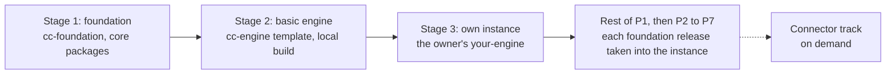
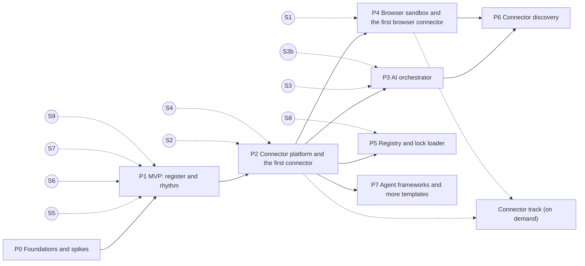

# 09 · Phased build plan

- **Purpose:** The order to build Command Center (CC) in. Four build stages (the foundation, a basic engine, the owner's own instance, then connectors on demand) laid over phases P0 to P7. Each phase has its scope, ordered tasks, a gate (acceptance criteria, manual checks and the open questions to settle first) and what the example user gets from it. P1, the MVP, is broken into ordered build steps grouped by stage. Connectors beyond the first one each platform phase needs form an on-demand connector track (§13).
- **Depends on:** every design file: [01](01-onboarding-and-frameworks.md), [02](02-rhythm-and-calendar.md), [03](03-decisions-and-action-items.md), [04](04-platform.md), [05](05-connectors.md), [06](06-connector-discovery.md), [07](07-agent-friendly-design.md), [08](08-repository-and-automation.md).
- **Related files:** [README](README.md) (index, conventions, cross-cutting open questions). [08 §6](08-repository-and-automation.md#6-scripts-deterministic-repeatable-mechanics) (`cc:trace`, which checks the gates).

## 1. Summary

### 1.1 Build order

Board, 7 Nov 2026: build the foundation first, then the basic engine, then copy the engine into a separate repository where the actual development begins; connectors come as the build needs them.

| Stage | Repository | What it delivers | Tasks | Ends when |
|---|---|---|---|---|
| 1. Foundation | `cc-foundation` | The repository, CI and scripts, the spikes the first two stages rely on, and the modular core packages the engine needs: schemas, store, domain, the core service with the local API, and the desktop shell | P0-01 to P0-03, P0-08, P0-10, P0-11, P0-13; P1-01 to P1-04, P1-10 | Gate P0 has passed and the stage-1 P1 steps are merged |
| 2. Basic engine | `cc-engine` | The engine template, with the engine's AI enforcement, running on the released `@cc/*` packages: clone, install, build and start, using `@cc/build` locally | P1-18, P1-16 | A fresh template copy builds and starts on macOS and Windows |
| 3. Own instance | the owner's *your-engine* (a private template copy, [08 §1](08-repository-and-automation.md#1-summary) rule 2) | The owner's own instance of CC, where actual development and real use begin. The remaining MVP features are built in `cc-foundation`, and each foundation release reaches the instance as a dependency PR. The owner's customisation (`cc.config`, theme, framework and pack files, later the calendar mapping) is developed in the instance itself. P2 to P7 continue the same way | P1-19, then P1-05 to P1-09, P1-11 to P1-15, P1-17; then P2 to P7 | Gate P1, then each later gate |
| Connector track | `cc-connectors`, later also the owner's *your-connectors* | Connectors built when the owner's instance needs them, once the platform phase they need has passed. Each platform phase ships with the first connector expected to need it: `google-calendar` with P2, `linkedin` with P4 | §13 | Per item |

### 1.2 Phases

| Phase | Name | What the example user gets | Requires |
|---|---|---|---|
| P0 | Foundations and spikes | Nothing to use yet: the `cc-foundation` repository, CI, the scripts and the spike decisions. Spikes that stages 1 and 2 do not rely on may run later, before the phase that relies on them (§5) | none |
| P1 | MVP: register and rhythm | First (stages 1 to 3) the core packages, a basic engine that builds and starts, and the owner's own instance. Then, delivered to that instance release by release: the weekly CEO review, monthly and quarterly reviews and the daily start and shutdown run from CC. Every item has one owner, a due date, done-means and a review. The calendar comes from an `.ics` import. Agents read and draft through `cc-axi` and MCP. Daily encrypted backups, locally and to a folder, with a restore test and a "last good backup" status | P0 |
| P2 | Connector platform and the first connector | Meetings live in Google Calendar (the first `calendar@1` connector, and the first connector the owner's instance is expected to need) and follow moves. The connector platform is in place: the full Policy Engine, the connector SDK and host, auth, bindings, the step runner, the scaffolding scripts and the `cc-connectors` repository. Every later connector arrives on demand through the connector track | P1 |
| P3 | AI orchestrator | The provider chosen at S8 runs through an adapter from `cc-connectors` (Codex CLI too, if spike S3b passes). AI drafts emails and posts, summarises pre-reads, turns notes into draft items, and gives advisory evidence reviews | P2 |
| P4 | Browser sandbox and the first browser connector | LinkedIn posts are verified automatically, in a separate, persistent session. WhatsApp and any other browser connector follow on demand | P2 |
| P5 | Registry and lock loader | Connectors install and update from the signed index in `cc-connectors` and, through `connectors.lock`, from the user's own connectors repository, with staged activation and rollback | P2 |
| P6 | Connector discovery | Hostinger (no connector): discovery researches every route, the user picks one, communication is proven live, and a build spec results. The user approves it on the review screen, and the ticket run files it in the engine repository | P3, P4 |
| P7 | Agent framework integration and more templates | firstmate builds approved connectors: approved ticket → PR in the user's connectors repository → include PR → restart → active. firstmate work (A-0144) is tracked from the fleet ledger; Grok bots use CC; `eos`, `okr` and `scaling-up` are available as the companies grow; Linux build | P1, P2 |
| Track | Connectors on demand (§13) | Gmail follow-ups sent after a confirmation and verified from the sent folder, merged PRs as evidence, Google Drive or S3 backups, WhatsApp, WordPress, Toggl, the social scheduler, Microsoft 365 and CalDAV calendars, a team task tracker (Google Sheets first, then Jira or Linear): each when the owner's instance needs it | P2 (P4 for browser connectors) |

## 2. Planning rules

1. **Vertical slices.** From stage 2 on, CC is an app the owner can build and run. Each phase ends with a releasable app on the beta channel that the example user can run for real. Unfinished features are hidden by build flags, never shown half-wired.
2. **The scenario is the fixture.** The reference scenario (Alderwick and Quillmarsh) is seeded by `cc:seed` and extended in every phase ([08 §8](08-repository-and-automation.md#8-testing-strategy)).
3. **Explicit task contracts.** Each task is a `BuildTask` (§3) with spec references, deliverables and acceptance IDs before it starts, following firstmate's "Every task gets an explicit contract before it starts" ([07 §2](07-agent-friendly-design.md#2-sources-read)). Ship tasks end in a PR. Scout tasks (the spikes) end in an ADR.
4. **Safety before capability.** AI arrives only after the full Policy Engine (P3 after P2). Browser automation arrives only with its guards (P4). Discovery arrives only when both AI and the guarded browser exist (P6).
5. **No calendar dates.** The plan orders work and gates it. It does not promise durations.
6. **Foundation, engine, own instance, in that order.** Stage 1 builds only the core packages the engine needs. Stage 2 proves the engine template on them. Stage 3 copies the engine into the owner's private repository; from then on, every foundation release is taken into that instance as a dependency PR and used for real.
7. **Connectors on demand.** Platform work stays in its phase (connectors in P2, the browser in P4, the registry in P5), each with the first connector expected to need it. Every other connector is a track item (§13), built when the owner's instance needs it.
8. **Marking progress.** A passed gate is marked done in its heading, `**Gate P0 (done).**`, and a done connector-track item by `(done)` after its ID in §13.3, `P2-08 (done)`. `cc:trace` then fails while any of that gate's or item's criteria has no test (C-08-07, C-09-06).

## 3. Types

```ts
type PhaseId = 'P0' | 'P1' | 'P2' | 'P3' | 'P4' | 'P5' | 'P6' | 'P7';
type Stage = 1 | 2 | 3;                // build-order stage (§1.1): 1 foundation, 2 basic engine, 3 own instance
type AcceptanceRef = `AC-${string}` | `manual:AC-${string}`;   // manual: checked by a person, recorded in the PR

interface BuildTask {
  id: `${PhaseId}-${string}`;          // "P1-07"; a connector-track item keeps the ID it had before the track existed
  phase: PhaseId;                      // for a connector-track item: the phase whose gate it needs (§13)
  stage?: Stage;                       // set on P0 and P1 tasks that are on the stage path (§1.1)
  track?: 'connector';                 // on-demand connector track (§13); not part of any phase gate
  shape: 'ship' | 'scout';             // firstmate task shapes: ship ends in a PR, scout ends in a report (an ADR)
  title: string;
  dependsOn: string[];                 // task IDs, always earlier in the list
  specRefs: string[];                  // "02 §4.3"
  deliverables: string[];              // packages, screens, scripts, ADRs
  acceptance: AcceptanceRef[];         // proved by tests in this task
  closesOpenQuestions?: string[];      // OQ IDs answered, or with the default accepted by the user
}

interface PhaseGate {
  phase: PhaseId;
  requires: PhaseId[];
  spikes: string[];                    // P0 scout tasks whose ADRs must be merged before the phase starts
  acceptance: AcceptanceRef[];         // all covered by passing tests (cc:trace --phase)
  openQuestions: string[];             // settled before the gate passes
  manualChecks: string[];
  dogfood?: string;                    // recommended real use before the next phase; the user's call
}
```

## 4. Dependency graph

Build stages:



Phases:



P3, P4 and P5 can run in parallel after P2, and the connector track runs alongside them. Dotted lines from a spike show which phase relies on it; its ADR must be merged before that phase starts (C-09-01). The dotted lines into the track show the earliest point a track item can start: after P2 for API connectors, after P4 for browser connectors.

## 5. P0: Foundations and spikes

Stage 1. P0 creates only `cc-foundation`. `cc-engine` is created in stage 2 (P1-18), and `cc-connectors` in P2 (P2-12), when the first connector needs it. Spikes P0-03, P0-08, P0-10, P0-11 and P0-13 are on the path of stages 1 to 3 and belong to gate P0. The other spikes (P0-04, P0-05, P0-06, P0-07, P0-09, P0-12) may run at any time, in parallel with the stages, but each must have a merged ADR before the phase that relies on it starts (§4).

| ID | Shape | Task | Spec | Acceptance |
|---|---|---|---|---|
| P0-01 | ship | Create the `cc-foundation` repository: layout, workspace, TypeScript config, lint and dependency rules D1-D7, CI on Linux, macOS and Windows, `AGENTS.md`, `CLAUDE.md`, ADR template. (The `cc-engine` part of this task moved to P1-18, and the `cc-connectors` part to P2-12) | [08 §4](08-repository-and-automation.md#4-repository-layout), [08 §5.1](08-repository-and-automation.md#51-cc-foundation), [08 §9](08-repository-and-automation.md#9-ci-and-release) | AC-08-01, AC-08-02, AC-08-04, AC-08-07 |
| P0-02 | ship | `cc:gen` skeleton (one record type end to end), `cc:trace`, `cc:doctor` | [08 §6](08-repository-and-automation.md#6-scripts-deterministic-repeatable-mechanics) | AC-08-03, AC-08-06 |
| P0-03 | scout | Choose the recurrence and time-zone libraries against fixtures: `BYDAY=-1FR`, `BYMONTH=3,6,9,12;BYDAY=-2FR`, the US daylight-saving weeks for a workstream's due dates in a US zone (`America/New_York`) | [02 §8.1](02-rhythm-and-calendar.md#81-series-all-times-ist-asiakolkata) | ADR |
| P0-04 | scout | **S1 Browser sessions.** Playwright persistent contexts, one profile per session, started from a `utilityProcess` or child process. Tests survival across restarts, cookie isolation between profiles, at-rest encryption on each OS, the sign-in window approach, and embedded versus separate windows. Before P4 | [04 §5](04-platform.md#5-browser-sandbox) | ADR; AC-04-02 prototype. Closes OQ-04-01, OQ-04-02, OQ-04-03 |
| P0-05 | scout | **S2 Connector run isolation.** Node permission-model flags inside an Electron `utilityProcess`; the fallback is a bundled Node with `--permission`. Before P2 | [04 §3](04-platform.md#3-process-architecture), [05 §10.2](05-connectors.md#102-rules) | ADR. Closes OQ-04-07 |
| P0-06 | scout | **S3 `claude_cli` provider.** The flag set of [04 §6.3](04-platform.md#63-providers-and-adapter-rules) against the installed Claude Code; tool access only through the relay; `stream-json` parsing; kill on budget. Before P3 | [04 §6](04-platform.md#6-ai-layer-providers-and-agent-profiles) | ADR; AC-04-06 prototype against a stub relay |
| P0-07 | scout | **S4 Google Calendar round trip.** Private extended properties (`cc_ws`, `cc_series`, `cc_instance`, `cc_rev`), lookup by property, change detection (sync tokens or polling), BYO desktop OAuth client with loopback redirect and PKCE. Before P2 | [02 §9](02-rhythm-and-calendar.md#9-calendar-integration), [05 §7](05-connectors.md#7-authentication-methods) | ADR; create, move and delete detected on a test calendar |
| P0-08 | scout | **S5 Local API and CLI.** JSON-RPC over a UNIX socket and a Windows named pipe from a `utilityProcess`; `axi-sdk-js` home view; `--version` fast-path latency; socket path limits | [04 §4](04-platform.md#4-local-api-and-identity), [07 §4](07-agent-friendly-design.md#4-cc-axi-the-axi-command-line) | ADR; AC-07-02 measured. Closes OQ-08-05 |
| P0-09 | scout | **S3b `codex_cli` provider.** With a logged-in Codex CLI: whether the disables of [04 §6.3](04-platform.md#63-providers-and-adapter-rules) leave only the allowlisted CC MCP tools (the docs say `unified_exec` opt-outs are ignored); whether a global `$CODEX_HOME/AGENTS.md` is still read under `--ignore-user-config`; which `default_tools_approval_mode` avoids prompts in `exec`; the usage and cost fields of `turn.completed`; whether `enabled_tools` takes bare tool names; kill on budget. Before P3 | [04 §6.3](04-platform.md#63-providers-and-adapter-rules) | ADR; AC-04-13 prototype against a stub relay. Decides whether `codex_cli` ships in P3 |
| P0-10 | scout | **S6 Engine extension API.** UI slots and theme tokens in the renderer under D3 (no Node, no network); `cc.config` validation; `cc:upgrade` codemods across an N−1 change | [08 §4.3](08-repository-and-automation.md#43-engine-extension-points) | ADR; AC-08-10 prototype |
| P0-11 | scout | **S7 Clean-tree start.** Detect a dirty engine checkout and lockfile drift at app start, fast enough for the 3-second cold start, and the labelled dirty-tree mode; detect a build older than the checkout, for the Rebuild now offer (owner decisions C1 and Rebuild now, 10 Nov 2026) | [04 §10](04-platform.md#10-packaging-updates-and-os-support) | ADR |
| P0-12 | scout | **S8 Verifiable packages from a private repository.** How a user's connectors repository CI produces packages CC can verify by sha256 pin; whether GitHub artifact attestations are available for private repositories on the user's plan. Before P5 | [05 §15.6](05-connectors.md#156-connectorslock-and-the-users-own-connectors) | ADR. Closes OQ-05-07 |
| P0-13 | scout | **S9 Harness deny rules.** The syntax and effect of `.claude/settings.json` deny rules for edits and shell, and a read-only Codex sandbox configuration, in the engine repository | [08 §5.2](08-repository-and-automation.md#52-cc-engine-and-each-your-engine) | ADR. Closes OQ-08-08 |

**Gate P0.** Acceptance: AC-08-01, AC-08-02, AC-08-03, AC-08-04, AC-08-06, AC-08-07. ADRs for P0-03, P0-08, P0-10, P0-11 and P0-13 merged. Open questions: OQ-08-01, OQ-08-02, OQ-08-05, OQ-08-06, OQ-08-07, OQ-08-08.

## 6. P1: MVP, register and rhythm

**In scope.** In build order: the core packages the engine needs (stage 1); the `cc-engine` repository and template with the "clone, install, run" path and a local build of the user's engine (stage 2); the owner's own instance (stage 3); then, delivered to that instance, the record model's full surface, frameworks and onboarding, the rhythm engine with agendas and the meeting runner, carry-forward and escalation, manual execution and the review loop, notifications, `.ics` export, the full `cc-axi` read and draft surface, the MCP server, hooks and the product skill, export, and encrypted backups (the local set, a folder destination, the restore test and the status). Signed beta builds are optional.

**Out of scope.** Connectors (onboarding step S7 records tools as *manual* or *later*), AI (step S8 records the choice, and nothing runs until P3), browser sessions, the registry.

### 6.1 Ordered build steps

Rows are in build order. IDs are kept from the earlier plan, so they are not in number order. Stage 3 steps start after P1-19 (C-09-05); they are built in `cc-foundation`, and each is taken into the owner's instance as it is released.

| ID | Stage | Task | Depends on | Spec | Acceptance |
|---|---|---|---|---|---|
| P1-01 | 1 | **Schemas.** Common types, every record type, API method schemas; `cc:gen` outputs for all of them | P0-02 | [03 §3](03-decisions-and-action-items.md#3-common-conventions), [03 §5](03-decisions-and-action-items.md#5-types), [04 §4.1](04-platform.md#41-endpoint-and-protocol) | AC-03-06 |
| P1-02 | 1 | **Store.** Migration 0001 with the tables of [03 §12](03-decisions-and-action-items.md#12-persistence), repository layer, event log in the same transaction, optimistic concurrency, FTS5, export, `cc:new-migration` (backups are P1-17) | P1-01 | [03 §12](03-decisions-and-action-items.md#12-persistence), [04 §9](04-platform.md#9-storage-secrets-and-data-location) | AC-03-07, AC-08-08 |
| P1-03 | 1 | **Domain.** Item lifecycle and transitions, invariants INV-03-01 to INV-03-12, health rules, decisions, issues and risks, the review loop with manual evidence (methods `confirmed` and `attested`), metrics | P1-01 | [03 §6](03-decisions-and-action-items.md#6-invariants) to [03 §11](03-decisions-and-action-items.md#11-issues-and-risks) | AC-03-01, AC-03-05, AC-03-08 |
| P1-04 | 1 | **Core service and local API.** Socket and named-pipe JSON-RPC, `auth.hello`, principals and tokens, actor rules, `E_HUMAN_REQUIRED` for every human-only operation, headless mode, schedulers on an injected clock | P1-02, P1-03, P0-08 | [04 §3](04-platform.md#3-process-architecture), [04 §4](04-platform.md#4-local-api-and-identity), [07 §5](07-agent-friendly-design.md#5-agent-principals-and-scopes) | AC-03-02, AC-04-08 |
| P1-10 | 1 | **Desktop shell.** Electron main, preload and renderer; core in a `utilityProcess`; hardening and fuses; single instance; `commandcenter://` deep links; tray; notifications with quiet hours | P1-04 | [04 §3](04-platform.md#3-process-architecture), [04 §10](04-platform.md#10-packaging-updates-and-os-support), [02 §10](02-rhythm-and-calendar.md#10-notifications) | AC-02-09 |
| P1-18 | 2 | **The `cc-engine` repository.** Layout, `AGENTS.md`, `CLAUDE.md`, the extension API skeleton (config schema, theme tokens for colours, fonts, radius and density only, with a fixed layout, owner decision Q9, 10 Nov 2026; UI slots, the `connectors.lock` format), CI, and the engine's AI enforcement (token scope, CODEOWNERS, branch protection, `cc:path-guard`, harness deny rules as decided in S9). Moved here from P0-01 | P0-01, P0-10, P0-13 | [08 §4](08-repository-and-automation.md#4-repository-layout), [08 §5.2](08-repository-and-automation.md#52-cc-engine-and-each-your-engine), [08 §9](08-repository-and-automation.md#9-ci-and-release) | AC-08-09 |
| P1-16 | 2 | **Engine template and local build (the basic engine).** The `cc-engine` template with the extension points of [08 §4.3](08-repository-and-automation.md#43-engine-extension-points), starting the desktop shell on the stage-1 core; `@cc/build` (electron-builder, hardening, fuses, clean-tree start); "clone, install, run" on macOS and Windows; foundation updates as dependency PRs with `cc:upgrade` (run by the user; `--check` in engine CI), which the user pulls; stale-build detection and the in-app Rebuild now, which writes only build output outside the checkout, then the idle restart (owner decisions D-1, C1 and Rebuild now, 10 Nov 2026); `cc:release` publishing the `@cc/*` packages. Features not built yet stay behind build flags. Signed beta builds are optional. Pulled forward from the end of P1 | P1-10, P1-18, P0-10, P0-11 | [04 §10](04-platform.md#10-packaging-updates-and-os-support), [08 §4](08-repository-and-automation.md#4-repository-layout), [08 §9](08-repository-and-automation.md#9-ci-and-release) | AC-04-14, AC-08-10, AC-08-11 (its "opens onboarding on first start" part is re-checked once P1-12 lands); a fresh template copy runs on both OSes (manual) |
| P1-19 | 3 | **The owner's own instance.** The owner copies `cc-engine` with "Use this template" into a private *your-engine* repository ([08 §1](08-repository-and-automation.md#1-summary) rule 2), turns on its CI, branch protection, the dependency-PR bot and the engine's AI enforcement, then installs, builds and starts it on their own machine. From here, each foundation release reaches the instance as a dependency PR the owner merges, and the owner's customisation is developed in the instance | P1-16 | [08 §1](08-repository-and-automation.md#1-summary), [08 §9](08-repository-and-automation.md#9-ci-and-release), [04 §10](04-platform.md#10-packaging-updates-and-os-support) | manual: the owner's copy builds and starts; the first foundation dependency PR is merged, the owner pulls it, and Rebuild now restarts the app on it |
| P1-05 | 3 | **`cc-axi` read and draft surface.** Home view, lists, views, create, update, claim, attach, history, search for items, decisions, issues, measures, goals and workstreams; structured errors; fast path; `cc:axi-conformance` | P1-04 | [07 §4](07-agent-friendly-design.md#4-cc-axi-the-axi-command-line) | AC-07-01, AC-07-02 |
| P1-06 | 3 | **Frameworks.** `personal-os`, `4dx` and `eos-lite` templates; packs; validators; `recommend()` with the availability rule; forking; `cc:new-template` | P1-01 | [01 §4](01-onboarding-and-frameworks.md#4-types) to [01 §6](01-onboarding-and-frameworks.md#6-decision-tree-inputs-rules-outputs), [01 §9](01-onboarding-and-frameworks.md#9-customisation-and-forking) | AC-01-01, AC-01-02, AC-01-03, AC-01-08. Closes OQ-01-04 |
| P1-07 | 3 | **Rhythm engine.** Series, RRULE expansion, horizon and materialisation, the instance state machine, absorption, merged meetings, portfolio series, placement around protected blocks, the time-budget check | P1-06, P1-02, P0-03 | [02 §4](02-rhythm-and-calendar.md#4-rhythm-engine), [01 §6.4](01-onboarding-and-frameworks.md#64-workspace-post-check) | AC-01-05, AC-02-01, AC-02-02, AC-02-06, AC-02-07 |
| P1-08 | 3 | **Agendas and meeting logic.** Agenda templates, input resolution, pre-read snapshots (no AI summary yet), output capture and validation, conclude and read-back | P1-07, P1-03 | [02 §5](02-rhythm-and-calendar.md#5-agenda-templates), [02 §6](02-rhythm-and-calendar.md#6-inputs-pre-reads-and-outputs) | covered by P1-15 scenario runs |
| P1-09 | 3 | **Carry-forward, escalation and `.ics` export** | P1-08 | [02 §7](02-rhythm-and-calendar.md#7-carry-forward-and-escalation), [02 §9.1](02-rhythm-and-calendar.md#91-providers) | AC-02-05, AC-02-08 |
| P1-11 | 3 | **Screens.** Home; Items (list, detail, review queue to confirm, attest or reject claims, accept drafts, drop; Confirm disabled without checkable evidence, Attest offered and counted separately, owner decision Q5); Decisions; Issues and risks (workspace-level risks on the Workspace pseudo-workstream, Q4); Meetings (week view, runner with timeboxes and capture, read-back; the daily start's attention list in fixed order, dismiss snoozes to tomorrow, Q6; daily start and shutdown capture items and notes, Q7); Scorecard (manual values, and a Goals tab where goals are editable any time and every change is logged, Q2); Settings (agent access, notifications, AI placeholder). No Confirmations screen in P1: confirmations are inline prompts that the deep link opens; the screen comes in P2-01 (Q3). Owner decisions Q2 to Q7, 10 Nov 2026 | P1-10, P1-08, P1-09 | [03 §7](03-decisions-and-action-items.md#7-action-item-lifecycle), [03 §9](03-decisions-and-action-items.md#9-evidence-and-the-review-loop), [02 §4.7](02-rhythm-and-calendar.md#47-timeline-of-one-instance), [02 §5.7](02-rhythm-and-calendar.md#57-portfolio-templates), [04 §4.3](04-platform.md#43-who-counts-as-the-user) | AC-03-09, AC-03-10, AC-03-11; UI end-to-end in P1-15 |
| P1-12 | 3 | **Onboarding.** Wizard S1 to S9 with all 67 questions of [01 §3.1](01-onboarding-and-frameworks.md#31-the-questions) (S1 includes the backup passphrase and destination; S7 includes the team task tracker question, owner decision C2); `cc-axi onboarding status`, `recommend`, `apply --dry-run` and `export`. Before P3, onboarding is manual entry or the deterministic import `apply --file profile.json`; the fixtures `fixtures/onboarding/sample-profile.json` and `.md` ([01 §3.2](01-onboarding-and-frameworks.md#32-answering-from-documents-and-the-sample-profile), owner decision Q10, 10 Nov 2026) | P1-06, P1-07, P1-11 | [01 §3](01-onboarding-and-frameworks.md#3-onboarding-flow), [01 §8](01-onboarding-and-frameworks.md#8-tailoring-questions-s5), [01 §9.1](01-onboarding-and-frameworks.md#91-where-answers-live) | AC-01-04, AC-01-06, manual:AC-01-07, AC-01-09, AC-01-10; re-checks AC-08-11's onboarding part |
| P1-13 | 3 | **MCP relay.** `cc-axi mcp` with the 14 tools; the connector tools return definitive empty results until P2; registration flow in Settings | P1-05 | [04 §8](04-platform.md#8-mcp-server), [07 §7](07-agent-friendly-design.md#7-mcp-server-surface) | AC-07-03 |
| P1-14 | 3 | **Hooks and product skill.** `cc-axi setup hooks` for Claude Code, Codex and OpenCode; `cc-axi hook session-start`; skill generation | P1-05 | [07 §8](07-agent-friendly-design.md#8-ambient-context-hooks-and-skill) | AC-07-05 (without Grok), AC-07-06 |
| P1-17 | 3 | **Backups.** Scheduled snapshots with the referenced blobs; passphrase-derived encryption (algorithm ADR); the 7 daily + 4 weekly local set; the folder destination; the synced-folder check for `<userData>`; the restore test; the "last good backup" status on Home and in Settings → Backups; human-only restore; attention items and the push on `failing` | P1-02, P1-10, P1-11 | [04 §9.1](04-platform.md#91-backups) | AC-04-10, AC-04-11, AC-04-12 |
| P1-15 | 3 | **Scenario end to end.** `cc:seed` on 2026-11-04, the fake clock through 2026-12-04 (first weekly review 2026-11-13, monthly absorption 2026-11-27), and Playwright runs of the human-only screens | P1-01 to P1-14 | [08 §8](08-repository-and-automation.md#8-testing-strategy) | re-runs every P1 criterion |

**Gate P1.** Acceptance: AC-01-01 to AC-01-06, AC-01-08, AC-01-09, AC-01-10, manual:AC-01-07; AC-02-01, AC-02-02, AC-02-05 to AC-02-09, AC-02-12; AC-03-01, AC-03-02, AC-03-05 to AC-03-11; AC-04-08, AC-04-10, AC-04-11, AC-04-12, AC-04-14; AC-07-01, AC-07-02, AC-07-03, AC-07-05 (without Grok), AC-07-06; AC-08-08, AC-08-09, AC-08-10, AC-08-11. Manual checks: the P1-16 template copy on both OSes, and the owner's instance of P1-19 running the gate's release. Open questions: OQ-01-01, OQ-01-02, OQ-01-03, OQ-01-04, OQ-01-07, OQ-03-02, OQ-03-06, OQ-04-08, OQ-04-10, OQ-04-11, OQ-04-12, OQ-07-02, OQ-08-03. Dogfood: the owner's instance is in real use from P1-19 on; recommended (the user's call): two weekly review cycles on the real rhythm in that instance before P2 starts.

## 7. P2: Connector platform and the first connector

P2 builds the connector platform together with the first connector that needs it. The expected first connector is `google-calendar` (P2-07): the rhythm is the owner's daily use from P1, and calendar-side moves that the `.ics` export cannot see are the first gap the instance hits (OQ-09-05). The other connectors this phase used to list (`gmail`, `github`, the scenario bindings, `google-drive` and `s3`) are now connector-track items (§13). Spikes P0-05 (S2) and P0-07 (S4) are merged before P2 starts.

| ID | Task | Spec | Acceptance |
|---|---|---|---|
| P2-12 | Create the `cc-connectors` repository: layout, per-kind D1 and D2 rules, CI, `AGENTS.md`. Moved here from P0-01 | [08 §4](08-repository-and-automation.md#4-repository-layout), [08 §5](08-repository-and-automation.md#5-agentsmd-for-each-repository), [08 §9](08-repository-and-automation.md#9-ci-and-release) | covered by AC-05-10 |
| P2-01 | Full Policy Engine: risk classes, evaluation order, payload-bound confirmations, standing approvals; the Confirmations screen (phase 2, owner decision Q3, 10 Nov 2026; P1 has inline prompts only) and deep links | [04 §7](04-platform.md#7-policy-engine-and-confirmations) | AC-04-04, AC-04-05 |
| P2-02 | Connector SDK and host: manifest validation, `ConnectorContext`, `ScopedHttp` with injected auth, run isolation as decided in S2, limits, cursor store, health and "Fix connector" items, records and ingest rules (drafts only) | [05 §5](05-connectors.md#5-manifest) to [05 §11](05-connectors.md#11-records-and-ingest) | AC-05-06 |
| P2-03 | Auth and secrets: `safeStorage` secret refs, `api_key`, `oauth2` with PKCE and loopback redirect, the guided BYO Google client setup | [05 §7](05-connectors.md#7-authentication-methods), [04 §9](04-platform.md#9-storage-secrets-and-data-location) | covered by P2-07 and by each track connector |
| P2-04 | Bindings and consent screens; onboarding S7 offers connectors | [05 §8](05-connectors.md#8-permissions-and-consent), [05 §9](05-connectors.md#9-bindings), [05 §16](05-connectors.md#16-onboarding-tool-selection-step-s7-and-the-reference-scenario) | none of its own |
| P2-05 | Step runner for connector performers; verification checks with retries and `inconclusive`; the `child_items` check | [03 §8](03-decisions-and-action-items.md#8-execution), [03 §9](03-decisions-and-action-items.md#9-evidence-and-the-review-loop) | none of its own; AC-03-03 and AC-03-04 prove it with `gmail` (P2-08, §13) |
| P2-06 | `cc:new-connector`, `cc:test-connector`, the no-AI enforcement per package kind, capability contracts (`implements`) checked at install | [05 §12](05-connectors.md#12-no-ai-in-connectors-enforcement), [05 §13](05-connectors.md#13-testing-contract) | AC-05-01, AC-05-10, AC-05-11, AC-08-05 |
| P2-07 | The `calendar@1` contract, the provider-neutral reconciliation suite with fake calendar services, several calendars per series, the calendar mapping; the `google-calendar` connector implementing it; live calendar writes and reconciliation. The first connector | [02 §9](02-rhythm-and-calendar.md#9-calendar-integration) | AC-02-03, AC-02-04, AC-02-10, AC-02-11, AC-05-04 |

If the owner's instance needs a different connector first (OQ-09-05), that connector takes P2-07's place as the first connector, and `google-calendar` becomes a track item. Each item's acceptance criteria and open questions move with it; the platform criteria stay in this gate.

**Gate P2.** Acceptance: AC-02-03, AC-02-04, AC-02-10, AC-02-11, AC-04-04, AC-04-05, AC-05-01, AC-05-04, AC-05-06, AC-05-10, AC-05-11, AC-08-05. Spikes: P0-05, P0-07. Open questions: OQ-02-01, OQ-02-06, OQ-02-07, OQ-03-04, OQ-04-07, OQ-05-01.

## 8. P3: AI orchestrator

Spikes P0-06 (S3) and P0-09 (S3b) are merged before P3 starts.

| ID | Task | Spec | Acceptance |
|---|---|---|---|
| P3-01 | `AiProvider` interface and adapter loading in the foundation's orchestrator (no AI SDK); adapters `claude_cli` (per S3), `anthropic_api` (default `claude-opus-5-5`) and `openai` (user-entered model ID) as packages in `cc-connectors`, with their README contracts; setup probes; `cc:new-adapter`, `cc:test-provider` | [04 §6.2](04-platform.md#62-provider-interface), [04 §6.3](04-platform.md#63-providers-and-adapter-rules) | AC-04-06, AC-04-07 |
| P3-07 | `codex_cli` adapter, only if spike S3b (P0-09) passed; onboarding S8 offers it once its lock entry is active | [04 §6.3](04-platform.md#63-providers-and-adapter-rules) | AC-04-13 |
| P3-02 | Agent profiles `drafter`, `extractor`, `planner`, `reviewer`, `summarize`, `tailor` as versioned prompts; tool allowlists narrowed per step | [04 §6.4](04-platform.md#64-agent-profiles) | covered by P3-06 |
| P3-03 | Data policy (`allow`, `redact_people`, `deny`) and untrusted-content wrapping, with the untrusted-text sanitiser | [04 §6.5](04-platform.md#65-data-policy-and-untrusted-content) | AC-04-09 |
| P3-04 | Agent steps in execution plans; budgets and usage; advisory AI review in the review loop (it never closes items) | [03 §8](03-decisions-and-action-items.md#8-execution), [03 §9.2](03-decisions-and-action-items.md#92-the-loop), [04 §6.6](04-platform.md#66-usage-and-budgets) | none of its own |
| P3-05 | Pre-read summaries; the extractor turns notes and emails into drafts; onboarding S8 enabled; **onboarding from documents**: the user uploads one or more documents, the extractor infers the 67 answers as suggestions (`suggested: true`), and the user approves them, changing only what is wrong (owner decision Q10, 10 Nov 2026). This is where the document path lands: it needs the AI layer, so it cannot come before P3 | [02 §6.2](02-rhythm-and-calendar.md#62-pre-read), [01 §3.2](01-onboarding-and-frameworks.md#32-answering-from-documents-and-the-sample-profile) | AC-01-11 |
| P3-06 | Scenario: A-0142 step s1 (drafter) end to end; A-0152 step 1 (drafter) drafting the confidential statement of work (a `sensitive` item), never inventing scope, prices or dates | [03 §13](03-decisions-and-action-items.md#13-worked-examples-reference-scenario) | scenario test |

**Gate P3.** Acceptance: AC-01-11, AC-04-06, AC-04-07, AC-04-09, and AC-04-13 if `codex_cli` ships. Spikes: P0-06, P0-09. Open questions: OQ-04-09. No agent framework is adopted ([04 §6.7](04-platform.md#67-orchestration-framework-no-langchain-or-langgraph-in-p3)). The `redact_people` data policy is exercised end to end on a test workstream outside the reference scenario (AC-04-09).

## 9. P4: Browser sandbox and the first browser connector

P4 builds the browser host and its guards together with the first browser connector expected to need them, `linkedin` (post verification for K-0001 and A-0160). Spike P0-04 (S1) is merged before P4 starts. `whatsapp-web` (formerly P4-04) is a connector-track item (§13).

| ID | Task | Spec | Acceptance |
|---|---|---|---|
| P4-01 | Browser host per S1: persistent contexts, engine pinning, the Sessions screen (create and delete are human-only), the sign-in flow, the "needs you" hand-off | [04 §5](04-platform.md#5-browser-sandbox) | AC-04-02 |
| P4-02 | Guards G1 to G8 and their test suite | [04 §5.5](04-platform.md#55-runtime-guards-applied-to-every-connector-run) | AC-04-01, AC-04-03 |
| P4-03 | `linkedin` connector (readers, pacing, `list_recent_posts`); A-0160's er1 check switched on. The first browser connector | [05 §17](05-connectors.md#17-reuse-of-existing-assets), [03 §13.2](03-decisions-and-action-items.md#132-a-0160-alderwick-linkedin-batch-week-47-recurring-template-mixed) | AC-05-05 |

**Gate P4.** Acceptance: AC-04-01, AC-04-02, AC-04-03, AC-05-05. Spikes: P0-04. Open questions: OQ-01-06, OQ-04-01, OQ-04-02, OQ-04-03.

## 10. P5: Registry and lock loader

P5 has no connector of its own. It moves the connectors shipped so far onto the signed index (P5-04); the first `repo` entry in a real lock is the first connector built for the owner (P7-05), and fixtures cover it before then. Spike P0-12 (S8) is merged before P5 starts. The marketing connectors (formerly P5-03) and the Microsoft 365 and CalDAV calendars (formerly P5-07) are connector-track items (§13).

| ID | Task | Spec | Acceptance |
|---|---|---|---|
| P5-01 | The signed index in `cc-connectors`: index build, signing in the protected release job, verification, GitHub Pages hosting | [05 §15.1](05-connectors.md#151-layout-and-publishing), [08 §6](08-repository-and-automation.md#6-scripts-deterministic-repeatable-mechanics) | none of its own |
| P5-02 | `registry-client`: search, install (human-only), signature checks, update with permission diff, rollback, connector developer mode | [05 §15.2](05-connectors.md#152-find) to [05 §15.5](05-connectors.md#155-connector-developer-mode) | AC-05-02, AC-05-03 (with a fixture `gmail` package if P2-08 has not shipped) |
| P5-04 | First-party connectors delivered through the index, with auto-update for unchanged permissions | [05 §15.4](05-connectors.md#154-update-and-rollback) | covered by AC-05-03 |
| P5-05 | The lock loader: `connectors.lock` entries from the index and from a user's repository (sha256 pin), staged activation with human-only consent, last-known-good lock, crash-loop disable, one-action rollback; `cc:include` | [05 §15.4](05-connectors.md#154-update-and-rollback), [05 §15.6](05-connectors.md#156-connectorslock-and-the-users-own-connectors) | AC-05-08, AC-05-09 |
| P5-06 | The template for a user's connectors repository: CI and release producing packages with their sha256 (and attestations, if spike S8 found them available) | [08 §9](08-repository-and-automation.md#9-ci-and-release) | covered by AC-05-08 |

**Gate P5.** Acceptance: AC-05-02, AC-05-03, AC-05-08, AC-05-09. Spikes: P0-12. Open questions: OQ-05-02, OQ-05-04, OQ-05-07, OQ-08-04.

## 11. P6: Connector discovery

| ID | Task | Spec | Acceptance |
|---|---|---|---|
| P6-01 | Discovery tools, click classification K1 to K8, the never-list blocks, ask-list confirmations, budgets, redaction, kill switch and audit; human-step capture | [06 §5](06-connector-discovery.md#5-discovery-tool-api), [06 §6](06-connector-discovery.md#6-safety-limits) | AC-06-01, AC-06-03, AC-06-04, AC-06-05, AC-06-07, AC-06-10 |
| P6-02 | Public research of every route kind, `PathOption[]`, the choice step (human-only) and the route consent | [06 §4](06-connector-discovery.md#4-procedure) | AC-06-08 |
| P6-03 | Live proof for API routes: secret capture without model exposure, key verification, OAuth with PKCE, MCP probe, export parsing; `communicationProof` from the audit log; the "communication proven" gate | [06 §7](06-connector-discovery.md#7-proving-an-api-route-key-oauth-mcp-or-export) | AC-06-02, AC-06-09 |
| P6-04 | Live proof for browser routes with `discovery_probe_selectors`; the report v2 with paths considered, proven exchange, human steps and narrative; the completeness checklist; `cc:new-connector --from-spec` | [06 §8](06-connector-discovery.md#8-proving-a-browser-route-the-logged-in-session), [06 §10](06-connector-discovery.md#10-connector-spec-report) | AC-06-06, AC-06-11 |
| P6-05 | Development requests and the review screen (human-only): approve applies `cc:approved` through the Issues-only token, reject, defer, the printed handoff brief | [06 §10.4](06-connector-discovery.md#104-development-requests), [06 §11.1](06-connector-discovery.md#111-review-screen) | AC-06-13 |
| P6-06 | The scheduled ticket run: the ticket-run standing approval, dedupe by run ID, reviewed and proven requests only | [06 §11.2](06-connector-discovery.md#112-ticket-run), [04 §7.4](04-platform.md#74-standing-approvals-and-pre-approved-payloads) | AC-06-12 |
| P6-07 | Adapter discovery: a missing AI adapter proven live through any working adapter; CLI adapters proven by a human step; provider `none` keeps a draft | [06 §7.5](06-connector-discovery.md#75-an-ai-provider-missing-adapter) | AC-06-14 |
| P6-08 | Hostinger run by the user (optional, manual): a proven spec report for Quillmarsh's hosting | [06 §9.1](06-connector-discovery.md#91-hostinger-quillmarsh-website-hosting) | manual |

**Gate P6.** Acceptance: AC-06-01 to AC-06-14. Open questions: OQ-06-01 to OQ-06-10 (defaults acceptable; OQ-06-05 and OQ-06-06 record where the design narrowed the board's wording).

## 12. P7: Agent framework integration and more templates

| ID | Task | Spec | Acceptance |
|---|---|---|---|
| P7-01 | `external_agent` performer, `cc-axi items handoff` and `items link`, the opt-in fleet-ledger reader | [07 §6.3](07-agent-friendly-design.md#63-operating-with-firstmate) | AC-07-04 |
| P7-02 | Grok hook writer and per-bot principals, after OQ-07-01 is verified | [07 §6.4](07-agent-friendly-design.md#64-grok) | AC-07-05 (Grok part) |
| P7-03 | `eos`, `okr` and `scaling-up` templates with parameter sets, invariants and recommender cases | [01 §5.4](01-onboarding-and-frameworks.md#54-later-templates-backbone-only-ship-in-p7) | AC-01-02 re-run with `eos` built; bounds and invariant tests like AC-01-03 for each template |
| P7-04 | Linux build of the engine | [04 §10](04-platform.md#10-packaging-updates-and-os-support) | install smoke test |
| P7-05 | The firstmate build loop: an approved request → a ship task in the user's connectors repository → PR → release with sha256 → include PR in the user's engine → idle pickup → staged activation → active or rolled back, with the issue closed or commented; end to end against fixture repositories and a fixture GitHub | [06 §11.3](06-connector-discovery.md#113-build-include-and-activate), [07 §6.3](07-agent-friendly-design.md#63-operating-with-firstmate) | AC-07-07 |

**Gate P7.** Acceptance: AC-07-04, AC-07-05 (Grok part), AC-07-07, AC-01-02 (with `eos`). Open questions: OQ-07-01, OQ-07-05.

## 13. Connector track (on demand)

Connectors arrive when the owner's instance needs them, not as fixed phase sets. Each platform phase ships with the first connector expected to need it; every other connector is a track item. A track item is a `BuildTask` with `track: 'connector'`. It keeps the ID it had in the earlier plan, so references elsewhere in the design still resolve. Its `phase` is the phase whose gate it needs (the Needs column), which can be earlier than its ID prefix. Phase labels on connectors in other files ([02 §8.2](02-rhythm-and-calendar.md#82-scorecard-lines-example-targets-set-at-s5), [02 §9.1](02-rhythm-and-calendar.md#91-providers), [03 §13.2](03-decisions-and-action-items.md#132-a-0160-alderwick-linkedin-batch-week-47-recurring-template-mixed), [05 §16](05-connectors.md#16-onboarding-tool-selection-step-s7-and-the-reference-scenario)) are those ID prefixes; when a connector can start is the Needs column below.

### 13.1 The first connector of each platform phase

| Phase | Platform it adds | First connector it is expected to need |
|---|---|---|
| P2 | Policy Engine, connector SDK and host, auth, bindings, the step runner, scaffolding, the `cc-connectors` repository | `google-calendar` (P2-07), for the owner's rhythm (OQ-09-05) |
| P4 | Browser host and guards | `linkedin` (P4-03), for post verification |
| P5 | Signed index, registry client, lock loader | None of its own: it moves the connectors shipped so far onto the index |
| P6, P7 | Discovery, the review screen and the firstmate build loop | The first tool with no connector at all; in the reference scenario, Hostinger (P6-08) |

### 13.2 How a need starts a track item

1. **Before P6.** The owner marked the tool *manual* or *later* at onboarding S7 ([05 §16](05-connectors.md#16-onboarding-tool-selection-step-s7-and-the-reference-scenario)), and the manual step now costs real time in the owner's instance; or a decision picks a tool (for example D-0008). The track item then gets its `BuildTask` contract and is built like any ship task.
2. **From P6.** A tool with no track item and no first-party connector goes through discovery ([06](06-connector-discovery.md)): research, the owner's route choice, live proof, the review screen, and the ticket run filing a development request in the owner's engine repository.
3. **From P7.** firstmate builds the approved request in the owner's connectors repository, and the include PR activates it ([06 §11.3](06-connector-discovery.md#113-build-include-and-activate)).

### 13.3 Track items

Rows are not in build order; the owner's needs set the order. An item that names several connectors may ship them one at a time, each with its own tests.

| ID | Connector | Needs | Likely trigger in the reference scenario | Spec | Acceptance | Settle first |
|---|---|---|---|---|---|---|
| P2-08 | `gmail`: `search_messages`, `create_draft`, `send_draft` (confirmation always) | P2 | The first follow-up email CC should send and verify (A-0142) | [05 §16](05-connectors.md#16-onboarding-tool-selection-step-s7-and-the-reference-scenario), [03 §13.1](03-decisions-and-action-items.md#131-a-0142-follow-up-to-a-consulting-lead-alderwick-mixed) | AC-03-03, AC-03-04 | none |
| P2-09 | `github`: `get_pull`, merged pull requests for the scorecard | P2 | Shipped-work evidence for K-0008 | [02 §8.2](02-rhythm-and-calendar.md#82-scorecard-lines-example-targets-set-at-s5) | covered by AC-05-07 | none |
| P2-10 | Scenario bindings `gcal-main`, `gmail-alderwick`, `gmail-quillmarsh`, `github-main` | P2-07, P2-08, P2-09 | When the last of those three connectors ships | [05 §16](05-connectors.md#16-onboarding-tool-selection-step-s7-and-the-reference-scenario) | AC-05-07 (live part manual) | none |
| P2-11 | Off-machine backup destinations through connectors: `google-drive` with the `drive.file` scope, and `s3`, under the backup standing approval | P2 | The owner wants backups off the machine beyond the folder destination | [04 §9.1](04-platform.md#91-backups), [04 §7.4](04-platform.md#74-standing-approvals-and-pre-approved-payloads) rule 6 | AC-04-10 re-run with each destination against a fixture service; one live upload and restore test per destination (manual) | none |
| P4-04 | `whatsapp-web` (read-mostly; unread chats become draft items; each send needs a confirmation), or the Business Platform API connector, per OQ-05-05 | P4 (P2 for the Business Platform API) | Alderwick's unread WhatsApp chats | [05 §16](05-connectors.md#16-onboarding-tool-selection-step-s7-and-the-reference-scenario) | connector fixture tests | OQ-05-05 |
| P5-03 | `wordpress` and `toggl-track` connectors; the scheduler connector chosen in D-0008 (`hootsuite`, or Buffer once OQ-05-06 is checked) | P2 | Blog drafts and publish checks; K-0004 client hours; D-0008 decided (due 2026-11-27) | [05 §16](05-connectors.md#16-onboarding-tool-selection-step-s7-and-the-reference-scenario), [03 §13.5](03-decisions-and-action-items.md#135-d-0008-which-social-scheduler-from-week-3) | connector fixture tests; K-0004 fed by `toggl-main` | OQ-05-06 (Buffer only) |
| P2-13 | Team task tracker (owner decision C2, 10 Nov 2026): `google-sheets` first, for teams with no Jira or Linear; then `jira` and `linear` when a team uses one | P2 | The S7 answer to "Where does your team track tasks?" names a tracker, or "none → Google Sheet", and keeping the team's tasks by hand costs real time | [05 §16](05-connectors.md#16-onboarding-tool-selection-step-s7-and-the-reference-scenario) item 4, [03 §8.5](03-decisions-and-action-items.md#85-team-task-trackers-owner-decision-c2), [01 §3](01-onboarding-and-frameworks.md#3-onboarding-flow) | connector fixture tests; its own criteria are written with its task contract | OQ-03-05, OQ-05-08, OQ-05-09 |
| P5-07 | `microsoft-calendar` (Microsoft Graph) and `caldav-calendar` connectors implementing `calendar@1` | P2, after the `calendar@1` contract (P2-07) | A calendar kept outside Google | [02 §9.1](02-rhythm-and-calendar.md#91-providers) | AC-02-10 for each, against fake services; one live round trip each (manual) | none |

## 14. Risks

| Risk | Phase | Mitigation |
|---|---|---|
| Vendor changes break the LinkedIn and WhatsApp Web connectors | P4, track | Quarantined, version-pinned adapters with live probes; degrade to user steps; `unofficial_surface` and `tos_risk` flags ([05 §3](05-connectors.md#3-connector-kinds)) |
| Terms-of-service exposure from browser automation | P4, track | Read-mostly use, pacing, no evasion (G8), consent at install, the Business Platform for WhatsApp sending (OQ-05-05) |
| Google OAuth friction: BYO client setup, 7-day tokens in Testing mode | P2 | Guided setup and a published consent screen ([05 §7](05-connectors.md#7-authentication-methods)) |
| `claude` or `codex` CLI flag drift | P3 | Version probe, `verified: false` for unknown versions, the nightly flag probes in `cc-connectors` ([08 §9](08-repository-and-automation.md#9-ci-and-release)) |
| Codex CLI cannot be limited to CC's tools | P0, P3 | Spike S3b before P3; `codex_cli` ships only if AC-04-13 passes |
| A foundation update breaks an engine's customisation | P1 onward | Extension points only, API N and N−1, `cc:upgrade` codemods, engine CI on every update PR. From P1-19 the owner's instance takes every release, so a break shows up in real use early |
| The basic engine of stage 2 is too thin to show what breaks | P1 | Stage 3 starts as soon as P1-19 runs, and each later P1 step is taken into the owner's instance as it lands; P1-15 still runs the whole scenario at the gate |
| A connector arrives too late because nobody records the need | track | Onboarding S7 records every tool as *manual* or *later*; the owner reviews those answers at each phase gate; from P6, discovery turns a missing tool into a request |
| A connector built for a user misbehaves | P5, P7 | Review and merge by the user, sha256 pin, static checks, staged activation, crash-loop disable, last-known-good rollback |
| The user loses the backup passphrase | P1 | Printable recovery sheet at setup; the local set keeps working; clear warning that CC cannot recover it |
| Prompt injection through ingested content | P3 onward | Untrusted wrapping, payload-bound confirmations, AI never closes items |
| A rhythm too heavy for a solo founder | P1 | The time-budget check T1, the dogfood gate, absorption and merged meetings |
| Scope creep into a multi-user team product | all | Single user in v1 (OQ-03-01, OQ-04-05) |

## 15. Contracts

1. **C-09-01** A phase starts only when every phase in its `requires` list has passed its gate and every spike in its `spikes` list has a merged ADR. Inside a phase, tasks start only when their `dependsOn` tasks are merged.
2. **C-09-02** Every task has a `BuildTask` contract before it starts. A ship task is done when its PR is merged with its acceptance tests passing and the design documents updated to match. A scout task is done when its ADR is merged.
3. **C-09-03** A gate passes when `cc:trace --phase <P>` reports every listed criterion covered by a passing test, manual checks are recorded in the gate PR, and every listed open question is answered or its default accepted by the user.
4. **C-09-04** A later phase never weakens an earlier phase's contracts. For example, P3 cannot bypass P2's confirmations, and P6 cannot relax P4's guards. A connector-track item never weakens the contracts of the phase it needs.
5. **C-09-05** Stage order. A stage-2 task starts only when gate P0 has passed and every stage-1 task is merged. A stage-3 task starts only when P1-19 is done. From P1-19 on, every foundation release is taken into the owner's instance as a dependency PR before the next phase gate is checked.
6. **C-09-06** A connector-track item starts only when the phase in its Needs column has passed its gate and the owner's instance needs it (§13.2). It is done like any ship task (C-09-02), and once it is marked done in this file, `cc:trace` keeps its criteria covered as it does for a passed gate.

## 16. Acceptance criteria

1. **AC-09-01** Every acceptance ID in files 01 to 08 appears in exactly one gate: a phase gate (§5 to §12) or a connector-track item (§13.3), with three declared exceptions: AC-07-05 is split between P1 and P7, AC-01-02 is re-run at P7, and AC-04-13 belongs to P3 only if `codex_cli` ships. `cc:trace` checks this.
2. **AC-09-02** In §6.1, every `dependsOn` entry refers to a P1 step in an earlier row or to a P0 task, and every step's stage is the same as or later than the stage of each P1 step it depends on.
3. **AC-09-03** At the P1 gate, one continuous scenario run from 2026-11-04 to 2026-12-04 passes every automated P1 criterion. Every `needs_decision` it raises is one the run's script expects and resolves.

## 17. Open questions

1. **OQ-09-01** Should AI drafting (P3) come before the connector platform (P2), so help arrives sooner? *Default: no. AI acts only after payload-bound confirmations exist.*
2. **OQ-09-02** Length of the dogfood period after P1, and whether it gates P2. *Default: two weekly review cycles in the owner's instance, recommended, not enforced; the user decides. Real use starts earlier, at P1-19.*
3. **OQ-09-03** If D-0008 is decided early (it is due 2026-11-27), should the scheduler connector move from P5 into P2? *Settled by the build order of 7 Nov 2026: the scheduler is a connector-track item (P5-03) that needs only P2, so it is built when D-0008 picks it and the owner's instance needs it. Until then, LinkedIn's built-in scheduler (option o1) covers the gap.*
4. **OQ-09-04** If OQ-01-01 resolves to "leads exist", team-mode meetings and multi-owner accountability move into P1 scope. The agendas already have team columns ([02 §5.1](02-rhythm-and-calendar.md#51-agendaeos-liteweekly1-60-min)). *Default: solo first.*
5. **OQ-09-05** Which connector does the owner's instance need first? *Default: `google-calendar`, so meetings follow moves made in the calendar. If the owner names another, it takes P2-07's place as P2's first connector (§7).*
